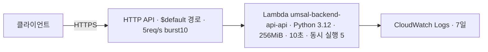

# 백엔드 API AWS 배포 (1·2단계)

기준일: 2026-11-05 · 이슈 #19(1단계), #49(2단계 기록). 1단계는 MVP 구현 전에 배포 경로를 검증하려고 코드를 API Gateway HTTP API + Lambda로 배포했다. 2단계에서 같은 API Lambda를 VPC 안으로 옮겨 RDS PostgreSQL·Cognito에 연결했다([2단계 배포 기록](#2단계-배포-기록)). DynamoDB·S3 원음·CloudFront 연결은 아직 없다. 아래 구조·절차는 1단계 기준이다.

## 구조



| 스택 | 템플릿 | 자원 |
|---|---|---|
| `umsal-backend-bootstrap` | [infra/aws/bootstrap.yaml](../infra/aws/bootstrap.yaml) | Lambda zip용 비공개 S3 버킷(암호화·HTTPS 강제·이전 버전 7일 만료, `Retain`) |
| `umsal-backend-api` | [infra/aws/api.yaml](../infra/aws/api.yaml) | HTTP API, Lambda, 실행 역할(자기 로그 쓰기만), 로그 그룹 2개, Errors 경보(알림 구독 없음) |

- 프로젝트 계정, 선택 리전 `ap-southeast-2`. umsal-pwa 스택(`umsal-pwa-demo*`, `umsal-demo-storage`)과 그 CloudFront는 건드리지 않는다.
- 직접 API 주소는 네트워크 제한 없이 열려 있다. 2단계부터 health를 뺀 업무 경로는 Cognito access token이 필요하다(D3). CloudFront `/api/*` 연결 방식은 아직 umsal-pwa와 정해야 한다.
- API 접근 로그는 요청 ID·경로 키·상태·응답 길이만 남긴다. 헤더·본문·쿼리·IP는 남기지 않는다.
- 스로틀링은 실수로 인한 비용을 줄이는 장치이며 절대 비용 상한이 아니다. Lambda 동시 실행이 5로 묶여 있어 동시 요청이 5를 넘으면 API Gateway 한도(burst 10) 안이라도 일부 요청이 5xx로 실패할 수 있다. 1단계에서는 의도한 제한이다.
- Lambda zip에는 Git이 추적하는 `src/umsal_backend` 파일만 들어간다. 무시 대상 로컬 파일(`.env` 등)은 포함하지 않는다.
- FastAPI 기본 `/docs`·`/openapi.json`도 같은 주소에서 열린다. 업무 API 배포 전(D3)에 비활성화나 보호를 정한다.

## 배포 절차

`aws login --profile ai-x-final`로 로그인한 상태에서 저장소 루트에서 실행한다. PR CI에는 AWS 권한을 주지 않으며 배포는 운영자가 직접 실행한다.

```bash
P="--profile ai-x-final --region ap-southeast-2"
# 1) artifact 버킷 (처음 한 번, 이후 변경 시만)
aws cloudformation deploy $P --stack-name umsal-backend-bootstrap \
  --template-file infra/aws/bootstrap.yaml --tags Project=umsal-backend
B=$(aws cloudformation describe-stacks $P --stack-name umsal-backend-bootstrap \
  --query 'Stacks[0].Outputs[0].OutputValue' --output text)
# 2) Linux x86_64 zip 빌드: src·pyproject.toml·uv.lock이 커밋된 상태여야 하며 이름은 HEAD SHA
python infra/aws/build_lambda.py
SHA=$(git rev-parse HEAD)
aws s3api put-object $P --bucket "$B" --key "lambda/$SHA.zip" --body ".local/lambda/$SHA.zip"
# 3) API 스택 생성/갱신
aws cloudformation deploy $P --stack-name umsal-backend-api --template-file infra/aws/api.yaml \
  --capabilities CAPABILITY_IAM --tags Project=umsal-backend \
  --parameter-overrides ArtifactBucket="$B" ArtifactKey="lambda/$SHA.zip"
```

템플릿 검사: `uvx --from cfn-lint==1.59.0 cfn-lint infra/aws/bootstrap.yaml infra/aws/api.yaml`.

## 배포 확인 기록

2026-11-05, 코드 commit `a8d36ea1881288f4ca557edf43812ab5686c5276`(zip 3,315,872바이트), 두 스택 `CREATE_COMPLETE`.

| 요청 | 결과 |
|---|---|
| `GET /health` | 200 `{"status":"ok","version":"0.1.0"}` (첫 요청 cold start 약 2.9초) |
| `GET /api/health/live` | 200 `{"status":"ok","service":"api","environment":"dev"}` |
| `GET /api/health/ready` | 503 `not_ready`, `aurora`·`dynamodb` 모두 `not_configured` (DB 미연결, 의도한 동작) |
| `GET /does-not-exist` | 404 |

직접 API 주소는 `umsal-backend-api` 스택의 `ApiEndpoint` 출력으로 확인한다.

## cfn-guard 결과와 판단

AWS IaC MCP의 cfn-guard 보안 규칙 검사에서 6건이 나왔고 다음처럼 판단했다.

| 규칙 | 판단 |
|---|---|
| S3 Object Lock·복제·접근 로그 | artifact 버킷에 과하다. 다른 리전 복제는 AGENTS의 AWS 규칙(new AWS experience: cross-Region 복제 금지)에 어긋난다 |
| S3 HTTPS 전용·공개 ACL 금지 | 거부 정책과 공개 차단 4개 설정이 이미 있다. 규칙이 기대하는 정책 형식과 달라 걸린 것으로 본다 |
| IAM inline policy | 권한이 자기 로그 쓰기뿐이고 umsal-pwa와 같은 방식이라 유지한다. 데이터 저장소 권한을 추가할 때 다시 검토한다 |

## 비용·중지·삭제

1단계 자원(API Gateway·Lambda·S3)은 소량 요청이면 무료 제공량 안에 든다. 2단계의 RDS 인스턴스는 상시 과금되며 견적은 [aws-stage2-design.md 3절](aws-stage2-design.md#3-비용-견적-ap-southeast-2)을 따른다. NAT는 없다. 실제 청구는 AWS Settings > Billing에서 확인한다.
즉시 중지하려면 함수의 reserved concurrency를 0으로 바꾼다. 스택 삭제는 운영자가 판단해 별도로 실행한다. artifact 버킷은 `Retain`이라 스택 삭제 뒤에도 남으므로 버전까지 직접 정리해야 한다.

## 2단계 배포 기록

설계는 [aws-stage2-design.md](aws-stage2-design.md)(VPC·RDS PostgreSQL·Cognito, 비용 견적). 2026-11-05에 코드 commit `35b9dec10b1b6ef5be86567ad7435d80e4aef8a8`(zip `lambda/<SHA>.zip`·`lambda/<SHA>-migrate.zip`)로 아래 순서대로 진행했다. 템플릿은 `jobs.yaml`만 #46 수정본이다.

| 순서 | 스택 / 동작 | 결과 |
|---|---|---|
| 1 | `umsal-backend-auth`([auth.yaml](../infra/aws/auth.yaml)) | 사용자 풀·웹 클라이언트·managed login 도메인 `umsal-family` |
| 2 | `umsal-backend-network`([network.yaml](../infra/aws/network.yaml)) | VPC, 프라이빗 서브넷 2개, Lambda·DB 보안 그룹 |
| 3 | `umsal-backend-database`([database.yaml](../infra/aws/database.yaml)) | RDS PostgreSQL 17.11, `db.t4g.micro`, 20GiB |
| 4 | `umsal-backend-db-bootstrap`([db-bootstrap.yaml](../infra/aws/db-bootstrap.yaml)) 생성 → invoke → 삭제 | `{"roles": ["umsal_app", "umsal_migrator"]}`, 삭제 후 `describe-stacks`가 `does not exist` |
| 5 | `umsal-backend-jobs`([jobs.yaml](../infra/aws/jobs.yaml)) | 첫 시도는 `DailyPurge` 실패로 롤백(#46), 수정 후 재생성 성공 |
| 6 | `umsal-backend-jobs-migrate` invoke | `{"before": null, "after": "0004"}` |
| 7 | `umsal-backend-api` 갱신 | change set은 `ApiFunction`·`ApiIntegration`·`FunctionRole` 수정만(교체 없음), API 주소 유지 |

절차(저장소 루트, `P="--profile ai-x-final --region ap-southeast-2"`):

1. `python infra/aws/build_lambda.py`와 `--kind migrate`로 두 zip을 만들어 artifact 버킷에 올린다.
2. `python infra/aws/stage2_params.py --api-key lambda/<SHA>.zip --migrate-key lambda/<SHA>-migrate.zip`로 `.local/stage2/*-params.json`을 만든다(Cognito JWKS를 이때 받아 고정).
3. 각 스택은 `aws cloudformation deploy $P --stack-name … --template-file … --capabilities CAPABILITY_IAM --tags Project=umsal-backend --parameter-overrides file://.local/stage2/<이름>-params.json --no-execute-changeset`으로 change set만 만들고, `describe-change-set`으로 자원 목록을 확인한 뒤 `execute-change-set`한다. 파라미터 파일은 `"Key=Value"` 문자열 목록이라 `deploy --parameter-overrides`용이다. `create-change-set --parameters`에는 쓸 수 없다.
4. bootstrap 스택은 invoke 직후 삭제한다(Secrets Manager 인터페이스 엔드포인트가 시간당 과금).

모든 템플릿은 생성 전에 `aws cloudformation validate-template`(읽기 전용)과 change set으로 확인한다. cfn-lint와 `validate-template` 모두 서비스 측 오류(#42의 Rules 미지원 함수, #46의 Scheduler 신뢰 조건)를 잡지 못할 수 있다.

### 2단계 확인 결과

| 요청 | 결과 |
|---|---|
| `GET /api/health/live` | 200 |
| `GET /api/health/ready` | 503 `not_ready`, `checks`: `aurora: ok`, `dynamodb: not_configured`, `database: unavailable`. DynamoDB는 다음 단계라 의도한 동작(D2) |
| `GET /api/me` (토큰 없음) | 401 |
| `GET /api/me` (합성 계정 access token) | 200, `user_id`와 빈 `display_name` |
| `GET /api/me` (같은 계정 id token) | 401 `UNAUTHENTICATED` (access token만 허용, D3) |

합성 계정 토큰은 웹 클라이언트로 받았다. 웹 클라이언트는 authorization code 흐름만 허용하므로(비밀번호 직접 인증 없음) 운영자가 PKCE `code_challenge`(S256)를 넣은 `/oauth2/authorize` 주소를 만들고, 브라우저에서 managed login으로 가입·로그인한 뒤 콜백 주소의 `code`를 `/oauth2/token`에서 `code_verifier`로 교환했다. 토큰과 verifier는 세션 임시 폴더에만 두고 확인 직후 지웠다.

### 운영 참고

- VPC 안 Lambda가 있는 스택의 삭제·롤백은 ENI 정리 때문에 20~40분 걸릴 수 있다. 그동안 같은 스택의 다른 자원(예: bootstrap의 Secrets Manager 엔드포인트)도 남아 과금된다.
- 실패해 `ROLLBACK_COMPLETE`가 된 스택은 갱신할 수 없으므로 삭제한 뒤 다시 만든다.

## 다음 단계

- DynamoDB·S3 원음 단계: 이것이 끝나야 `/api/health/ready`가 200이 된다.
- CloudFront `/api/*`를 이 API로 보낼지(경로 분리 포함) umsal-pwa와 조율
