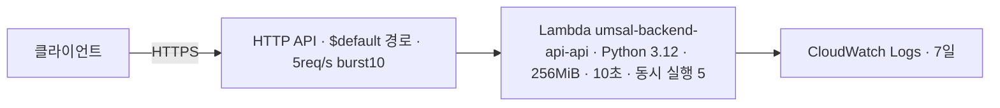

# 백엔드 API AWS 배포 (1·2·3단계)

기준일: 2026-11-08 · 이슈 #19(1단계), #49(2단계 기록), #54(3단계 기록), #62(호칭 배포). 1단계는 MVP 구현 전에 배포 경로를 검증하려고 코드를 API Gateway HTTP API + Lambda로 배포했다. 2단계에서 같은 API Lambda를 VPC 안으로 옮겨 RDS PostgreSQL·Cognito에 연결했다([2단계 배포 기록](#2단계-배포-기록)). 3단계에서 DynamoDB 테이블과 원음 S3 버킷(기반만)을 만들어 ready가 200이 됐다([3단계 배포 기록](#3단계-배포-기록)). 2026-11-08부터 PWA CloudFront의 `/api/*`(푸시 `/api/push/*` 제외)가 이 API로 간다([CloudFront 연결](#cloudfront-연결-umsal-pwa-115)). 아래 구조·절차는 1단계 기준이다.

## 구조



| 스택 | 템플릿 | 자원 |
|---|---|---|
| `umsal-backend-bootstrap` | [infra/aws/bootstrap.yaml](../infra/aws/bootstrap.yaml) | Lambda zip용 비공개 S3 버킷(암호화·HTTPS 강제·이전 버전 7일 만료, `Retain`) |
| `umsal-backend-api` | [infra/aws/api.yaml](../infra/aws/api.yaml) | HTTP API, Lambda, 실행 역할(1단계: 자기 로그 쓰기만. 2단계: VPC ENI 관리와 앱 DB 사용자 하나에 대한 `rds-db:connect` 추가. 3단계: 결과 테이블 하나에 대한 `dynamodb:DescribeTable` 추가), 로그 그룹 2개, Errors 경보(알림 구독 없음) |
| `umsal-backend-storage` (3단계) | [infra/aws/storage.yaml](../infra/aws/storage.yaml) | DynamoDB 결과 테이블, 원음 S3 버킷과 정책(둘 다 `Retain`). 2단계 스택은 [2단계 배포 기록](#2단계-배포-기록) 참고 |

- 프로젝트 계정, 선택 리전 `ap-southeast-2`. umsal-pwa 스택(`umsal-pwa-demo*`, `umsal-demo-storage`)과 그 CloudFront는 건드리지 않는다.
- 직접 API 주소는 네트워크 제한 없이 열려 있다. 2단계부터 health를 뺀 업무 경로는 Cognito access token이 필요하다(D3). PWA CloudFront `/api/*`도 같은 API로 연결돼 있다(umsal-pwa #115).
- API 접근 로그는 요청 ID·경로 키·상태·응답 길이만 남긴다. 헤더·본문·쿼리·IP는 남기지 않는다.
- 스로틀링은 실수로 인한 비용을 줄이는 장치이며 절대 비용 상한이 아니다. Lambda 동시 실행이 5로 묶여 있어 동시 요청이 5를 넘으면 API Gateway 한도(burst 10) 안이라도 일부 요청이 5xx로 실패할 수 있다. 1단계에서는 의도한 제한이다.
- Lambda zip에는 Git이 추적하는 `src/umsal_backend` 파일만 들어간다. 무시 대상 로컬 파일(`.env` 등)은 포함하지 않는다.
- FastAPI 기본 `/docs`·`/openapi.json`도 같은 주소에서 열린다. 업무 API 배포 전(D3)에 비활성화나 보호를 정한다.

## 배포 절차

`aws login --profile ai-x-final`로 로그인한 상태에서 저장소 루트에서 실행한다. PR CI에는 AWS 권한을 주지 않으며 배포는 운영자가 직접 실행한다.

```bash
P="--profile ai-x-final --region ap-southeast-2"
# 1) artifact 버킷 (처음 한 번, 이후 변경 시만)
aws cloudformation deploy $P --stack-name umsal-backend-bootstrap \
  --template-file infra/aws/bootstrap.yaml --tags Project=umsal-backend
B=$(aws cloudformation describe-stacks $P --stack-name umsal-backend-bootstrap \
  --query 'Stacks[0].Outputs[0].OutputValue' --output text)
# 2) Linux x86_64 zip 빌드: src·pyproject.toml·uv.lock이 커밋된 상태여야 하며 이름은 HEAD SHA
python infra/aws/build_lambda.py
SHA=$(git rev-parse HEAD)
aws s3api put-object $P --bucket "$B" --key "lambda/$SHA.zip" --body ".local/lambda/$SHA.zip"
# 3) API 스택 생성/갱신
aws cloudformation deploy $P --stack-name umsal-backend-api --template-file infra/aws/api.yaml \
  --capabilities CAPABILITY_IAM --tags Project=umsal-backend \
  --parameter-overrides ArtifactBucket="$B" ArtifactKey="lambda/$SHA.zip"
```

템플릿 검사: `uvx --from cfn-lint==1.59.0 cfn-lint infra/aws/*.yaml`.

## 배포 확인 기록

2026-11-05, 코드 commit `a8d36ea1881288f4ca557edf43812ab5686c5276`(zip 3,315,872바이트), 두 스택 `CREATE_COMPLETE`.

| 요청 | 결과 |
|---|---|
| `GET /health` | 200 `{"status":"ok","version":"0.1.0"}` (첫 요청 cold start 약 2.9초) |
| `GET /api/health/live` | 200 `{"status":"ok","service":"api","environment":"dev"}` |
| `GET /api/health/ready` | 503 `not_ready`, `aurora`·`dynamodb` 모두 `not_configured` (DB 미연결, 의도한 동작) |
| `GET /does-not-exist` | 404 |

직접 API 주소는 `umsal-backend-api` 스택의 `ApiEndpoint` 출력으로 확인한다.

## cfn-guard 결과와 판단

AWS IaC MCP의 cfn-guard 보안 규칙 검사에서 6건이 나왔고 다음처럼 판단했다.

| 규칙 | 판단 |
|---|---|
| S3 Object Lock·복제·접근 로그 | artifact 버킷에 과하다. 다른 리전 복제는 AGENTS의 AWS 규칙(new AWS experience: cross-Region 복제 금지)에 어긋난다 |
| S3 HTTPS 전용·공개 ACL 금지 | 거부 정책과 공개 차단 4개 설정이 이미 있다. 규칙이 기대하는 정책 형식과 달라 걸린 것으로 본다 |
| IAM inline policy | 1단계 판단: 권한이 자기 로그 쓰기뿐이고 umsal-pwa와 같은 방식이라 유지한다. 2단계에서 추가한 VPC ENI·`rds-db:connect`(앱 DB 사용자 하나로 한정)와 3단계의 `dynamodb:DescribeTable`(테이블 하나로 한정)도 같은 inline 방식을 쓴다. 결과 항목·S3 읽기·쓰기 권한을 추가할 때 cfn-guard를 다시 돌려 검토한다 |

## 비용·중지·삭제

1단계 자원(API Gateway·Lambda·S3)은 소량 요청이면 무료 제공량 안에 든다. 2단계의 RDS 인스턴스는 상시 과금되며 견적은 [aws-stage2-design.md 3절](aws-stage2-design.md#3-비용-견적-ap-southeast-2)을 따른다. 3단계의 DynamoDB·S3는 시간당 요금 없이 사용량만 과금된다([aws-stage3-design.md 3절](aws-stage3-design.md#3-비용-ap-southeast-2)). NAT는 없다. 실제 청구는 AWS Settings > Billing에서 확인한다.
즉시 중지하려면 함수의 reserved concurrency를 0으로 바꾼다. 스택 삭제는 운영자가 판단해 별도로 실행한다. artifact 버킷은 `Retain`이라 스택 삭제 뒤에도 남으므로 버전까지 직접 정리해야 한다.

## 2단계 배포 기록

설계는 [aws-stage2-design.md](aws-stage2-design.md)(VPC·RDS PostgreSQL·Cognito, 비용 견적). 2026-11-05에 코드 commit `35b9dec10b1b6ef5be86567ad7435d80e4aef8a8`(zip `lambda/<SHA>.zip`·`lambda/<SHA>-migrate.zip`)로 아래 순서대로 진행했다. 템플릿은 `jobs.yaml`만 #46 수정본이다.

| 순서 | 스택 / 동작 | 결과 |
|---|---|---|
| 1 | `umsal-backend-auth`([auth.yaml](../infra/aws/auth.yaml)) | 사용자 풀·웹 클라이언트·managed login 도메인 `umsal-family` |
| 2 | `umsal-backend-network`([network.yaml](../infra/aws/network.yaml)) | VPC, 프라이빗 서브넷 2개, Lambda·DB 보안 그룹 |
| 3 | `umsal-backend-database`([database.yaml](../infra/aws/database.yaml)) | RDS PostgreSQL 17.11, `db.t4g.micro`, 20GiB |
| 4 | `umsal-backend-db-bootstrap`([db-bootstrap.yaml](../infra/aws/db-bootstrap.yaml)) 생성 → invoke → 삭제 | `{"roles": ["umsal_app", "umsal_migrator"]}`, 삭제 후 `describe-stacks`가 `does not exist` |
| 5 | `umsal-backend-jobs`([jobs.yaml](../infra/aws/jobs.yaml)) | 첫 시도는 `DailyPurge` 실패로 롤백(#46), 수정 후 재생성 성공 |
| 6 | `umsal-backend-jobs-migrate` invoke | `{"before": null, "after": "0004"}` |
| 7 | `umsal-backend-api` 갱신 | change set은 `ApiFunction`·`ApiIntegration`·`FunctionRole` 수정만(교체 없음), API 주소 유지 |

절차(저장소 루트, `P="--profile ai-x-final --region ap-southeast-2"`):

1. 표의 1~3(auth·network·database)을 먼저 만든다. 이 셋은 파라미터 파일 없이 템플릿 기본값을 쓰며, database만 network 출력값(서브넷·DB 보안 그룹)을 `--parameter-overrides`로 넘긴다.
2. `python infra/aws/build_lambda.py`와 `--kind migrate`로 두 zip을 만들어 artifact 버킷에 올린다.
3. `python infra/aws/stage2_params.py --api-key lambda/<SHA>.zip --migrate-key lambda/<SHA>-migrate.zip`로 `.local/stage2/{db-bootstrap,jobs,api}-params.json`을 만든다. 1의 세 스택 출력값을 읽으므로 그 뒤에 실행한다(Cognito JWKS를 이때 받아 고정).
4. 표의 4~7 스택은 `aws cloudformation deploy $P --stack-name … --template-file … --capabilities CAPABILITY_IAM --tags Project=umsal-backend --parameter-overrides file://.local/stage2/<이름>-params.json --no-execute-changeset`으로 change set만 만들고, `describe-change-set`으로 자원 목록을 확인한 뒤 `execute-change-set`한다. 파라미터 파일은 `"Key=Value"` 문자열 목록이라 `deploy --parameter-overrides`용이다. `create-change-set --parameters`에는 쓸 수 없다.
5. bootstrap 스택은 invoke 직후 삭제한다(Secrets Manager 인터페이스 엔드포인트가 시간당 과금).

모든 템플릿은 생성 전에 `aws cloudformation validate-template`(읽기 전용)과 change set으로 확인한다. cfn-lint와 `validate-template` 모두 서비스 측 오류(#42의 Rules 미지원 함수, #46의 Scheduler 신뢰 조건)를 잡지 못할 수 있다.

### 2단계 확인 결과

| 요청 | 결과 |
|---|---|
| `GET /api/health/live` | 200 |
| `GET /api/health/ready` | 503 `not_ready`, `checks`: `aurora: ok`, `dynamodb: not_configured`, `database: unavailable`. DynamoDB는 다음 단계라 의도한 동작(D2) |
| `GET /api/me` (토큰 없음) | 401 |
| `GET /api/me` (합성 계정 access token) | 200, `user_id`와 빈 `display_name` |
| `GET /api/me` (같은 계정 id token) | 401 `UNAUTHENTICATED` (access token만 허용, D3) |

합성 계정 토큰은 웹 클라이언트로 받았다. 웹 클라이언트는 authorization code 흐름만 허용하므로(비밀번호 직접 인증 없음) 운영자가 PKCE `code_challenge`(S256)를 넣은 `/oauth2/authorize` 주소를 만들고, 브라우저에서 managed login으로 가입·로그인한 뒤 콜백 주소의 `code`를 `/oauth2/token`에서 `code_verifier`로 교환했다. 토큰과 verifier는 세션 임시 폴더에만 두고 확인 직후 지웠다.

### 운영 참고

- VPC 안 Lambda가 있는 스택의 삭제·롤백은 ENI 정리 때문에 20~40분 걸릴 수 있다. 그동안 같은 스택의 다른 자원(예: bootstrap의 Secrets Manager 엔드포인트)도 남아 과금된다.
- 실패해 `ROLLBACK_COMPLETE`가 된 스택은 갱신할 수 없으므로 삭제한 뒤 다시 만든다.

## 3단계 배포 기록

설계는 [aws-stage3-design.md](aws-stage3-design.md)(#52). 2026-11-05에 코드 commit `3611c1e1a366acd2ca02e820a603df17e35b4988`(PR #53)로 진행했다. 두 템플릿은 생성 전에 `validate-template`을 통과했다.

| 순서 | 스택 / 동작 | 결과 |
|---|---|---|
| 1 | `umsal-backend-storage`([storage.yaml](../infra/aws/storage.yaml)) | change set은 `ResultsTable`·`AudioBucket`·`AudioBucketPolicy` 추가만, `CREATE_COMPLETE` |
| 2 | API zip 빌드·업로드 | `lambda/3611c1e….zip` |
| 3 | `stage2_params.py --with-storage` | `api-params.json`에 `DynamoTableName` 추가(10개 파라미터) |
| 4 | `umsal-backend-api` 갱신 | change set은 `ApiFunction`·`ApiIntegration`·`FunctionRole` 수정만(교체 없음), API 주소 유지 |

| 요청 | 결과 |
|---|---|
| `GET /api/health/live` | 200 |
| `GET /api/health/ready` | 200 `ready`, `checks`: `database: ok`, `aurora: ok`, `dynamodb: ok`. 첫 요청(새 Lambda 실행 환경) 약 7.3초, 이후 약 0.8~1.0초 |
| `GET /api/me` (토큰 없음) | 401 |

- 생성 뒤 조회(2026-11-05): 테이블 `ACTIVE`·`PAY_PER_REQUEST`·삭제 보호 켜짐·항목 0개(`Scan` COUNT), 버킷 버전 관리 `Enabled`·객체와 버전 0개(`ListObjectVersions`). API 역할은 테이블에 `dynamodb:DescribeTable`만 있고 버킷 권한은 없다.
- 두 자원 모두 `Retain`이라 스택을 지워도 남는다(테이블은 삭제 보호도 먼저 꺼야 한다). 정리는 사용자가 판단해 별도로 한다.
- 템플릿 검사: `cfn-lint 1.59.0`으로 `storage.yaml`·`api.yaml` 통과. cfn-guard는 이번에 실행하지 않았다.
- AWS 가격 도구 MCP는 `aws login` 자격 증명에 필요한 `botocore[crt]`가 없어 실패했고, 단가는 `aws pricing get-products`(us-east-1 엔드포인트)로 조회했다([설계 3절](aws-stage3-design.md#3-비용-ap-southeast-2)).

## 로그인 화면 브랜딩 (#57)

Cognito managed login(로그인·회원가입 화면)은 `auth.yaml`의 `Branding`(`AWS::Cognito::ManagedLoginBranding`)으로 엄살 브랜드를 적용한다. 기준은 umsal-pwa `docs/brand-identity.md`(UMSAL Forest, 메인 `#176B50`)다.

- 설정: Cognito 기본값(`describe-managed-login-branding-by-client --return-merged-resources`)에서 라이트 모드 색만 브랜드 팔레트로 바꿨다. 주요 버튼·링크·포커스는 Forest Green, 누름은 Pressed Green, 글자는 Ink·Muted, 페이지 배경은 Canvas(기본 배경 그림 끔). 라이트 모드 고정(PWA 라이트 전용), 모서리는 폼 16·버튼 12·입력 10.
- 로고: [infra/aws/branding/logo-symbol.png](../infra/aws/branding/logo-symbol.png)(umsal-pwa `apps/web/public/brand/logo-symbol.png`, 128px, 13,232바이트)를 폼 상단에 표시한다. 템플릿에는 base64로 들어가며 `tests/test_auth_branding.py`가 저장소 파일과 같은지, 라이트 모드에 AWS 기본 파란색이 남지 않았는지 확인한다.
- 파비콘: 로고를 48px로 줄인 PNG-in-ICO([favicon.ico](../infra/aws/branding/favicon.ico), 2,907바이트)만 쓴다(`enabledTypes: [ICO]`). `UseCognitoProvidedValues: false`라 이 두 자산 외의 Cognito 기본 자산(배경·안내 그래픽, SVG 파비콘)은 없으며, 배경 그림과 폼 그래픽(`displayGraphics`)은 껐다.
- 대비: 테스트가 라이트 모드의 주요 글자·배경 조합(버튼, 제목, 본문, 설명, 링크, 드롭다운 선택 항목)이 WCAG AA 4.5:1 이상인지 확인한다. 비활성 주요 버튼은 Soft Sage 배경·Green 200 테두리로 흰 폼과 구분한다.
- 템플릿이 51,200바이트를 넘으면 `aws cloudformation deploy`에 `--s3-bucket`이 필요하다(테스트로 한도 안을 확인).
- 시연 주소에 `lang=ko`를 붙이면 화면 문구가 한국어로 나온다(managed login 지원 언어).

## CloudFront 연결 (umsal-pwa #115)

umsal-pwa 이슈 #114, PR #115(병합 `057fd4e`, 2026-11-08)로 PWA CloudFront 배포(`d86lxzcp0rvt4.cloudfront.net`)의 경로를 나눴다. `/api/push/*`는 기존 PWA 푸시 API, 나머지 `/api/*`는 이 백엔드 API로 간다. CSP `connect-src`에 Cognito 도메인을 더했다. 변경은 umsal-pwa 스택의 change set(Distribution·SecurityHeaders 수정, 교체 없음)으로 적용했고, 이 저장소의 스택은 바뀌지 않았다. 확인: CloudFront 경유 `/api/health/ready` 200, `/api/push/config` 200, `/api/me` 401.

## 연결별 호칭 배포 기록 (#62)

2026-11-08에 코드 commit `110b6b4522184f1c89a3c31e19c5267cb11e3792`(PR #63, D10)로 진행했다. 템플릿은 바뀌지 않았고 코드와 스키마만 바뀌었다. 새 API 코드는 `connection_labels` 테이블을 쓰므로 마이그레이션을 API 갱신보다 먼저 했다.

| 순서 | 동작 | 결과 |
|---|---|---|
| 1 | API·migrate zip 빌드·업로드 | `lambda/110b6b4….zip`(30,814,696바이트), `lambda/110b6b4…-migrate.zip`(35,977,544바이트) |
| 2 | `stage2_params.py --with-storage` | `jobs-params.json`·`api-params.json` 재생성(JWKS 키 2개) |
| 3 | `umsal-backend-jobs` 갱신 | change set은 `MigrationFunction`·`MaintenanceFunction`의 `Code`만 수정(교체 없음), `UPDATE_COMPLETE`. 이전 코드는 `35b9dec` |
| 4 | 마이그레이션 Lambda invoke | `{"before": "0004", "after": "0005"}` |
| 5 | `umsal-backend-api` 갱신 | change set은 `ApiFunction`의 `Code`만 수정(교체 없음), `UPDATE_COMPLETE`. 이전 코드는 `723142a` |

| 요청(직접 주소와 CloudFront 모두) | 결과 |
|---|---|
| `GET /api/health/ready` | 200 `ready`, `database`·`aurora`·`dynamodb` 모두 `ok`. 직접 주소 첫 요청(새 실행 환경) 약 9.3초 |
| `GET /api/me`, `GET /api/connections` (토큰 없음) | 401 |
| `PUT /api/connections/{id}/label` (토큰 없음, CloudFront) | 401 |

- 실제 계정 토큰으로 호칭을 저장·조회하는 확인은 PWA 가족 화면(umsal-pwa #120) 배포 뒤 사용자가 한다.
- `aws cloudformation deploy`에 `--tags Project=umsal-backend`를 빼면 change set이 모든 자원의 `Project` 태그를 지우는 수정으로 잡힌다. 이번에 첫 change set에서 이를 발견해 실행하지 않고 지운 뒤 태그를 넣어 다시 만들었다. 실행 전에 `describe-change-set --include-property-values`로 `Tags` 변경이 없는지 본다.

## DB 조회 Lambda 기록

이슈 #60. VPC 안 RDS를 운영자가 `aws lambda invoke`로 읽기 전용 조회한다. 코드는 [db_inspect.py](../src/umsal_backend/db_inspect.py), 템플릿은 [db-inspect.yaml](../infra/aws/db-inspect.yaml)(스택 `umsal-backend-db-inspect`, API Gateway 없음, `umsal_app`만 `rds-db:connect`).

- 요청: `{"action": "tables"}`(테이블별 행 수), `{"action": "rows", "table": "users", "limit": 20}`(최대 100행). 임의 SQL은 받지 않고 READ ONLY 트랜잭션에서 실행한다. 로그에는 동작·테이블·행 수만 남긴다.
- 호출: `aws lambda invoke $P --function-name umsal-backend-db-inspect --cli-binary-format raw-in-base64-out --payload '{"action":"tables"}' out.json`. 응답에는 행 내용이 있으므로 `out.json`은 확인 후 지운다.
- 2026-11-06 배포: commit `c1dfda7`. 업로드 속도(약 35KB/s) 때문에 API zip에서 Lambda 런타임이 제공하는 boto3·botocore와 DB 경로가 쓰지 않는 cryptography를 뺀 `lambda/<SHA>-inspect.zip`(9MB)을 썼다. change set은 `InspectFunction`·`InspectLog`·`InspectRole` 추가만, `CREATE_COMPLETE`.
- 확인: `tables` → `alembic_version 1, users 1`, 나머지 0. `rows`(`users`)는 합성 계정 1행. `pg_roles` 요청은 `Unknown table in schema public.`로 거부.
- 사고 기록: 2026-11-05 23:32~23:35 UTC 콘솔에서 DB 보안 그룹 `sg-0d313953176c1816d`의 Lambda SG 허용 규칙이 삭제되고 공인 IP `/32` 규칙만 남아 API ready가 `database: unavailable`이 됐다(재부팅으로는 해결 안 됨). 2026-11-06 Lambda SG → 5432 규칙을 다시 추가해 ready가 200으로 돌아왔다. DB는 `PubliclyAccessible: false`라 공인 IP 규칙으로는 접속할 수 없다. 남은 공인 IP 규칙은 network 스택 템플릿과 어긋나는 drift이며 삭제 여부는 사용자가 정한다.

## 다음 단계

- 업로드·작업·결과 API(항목 키 설계, S3 CORS·presigned URL, API의 항목·버킷 권한): MVP 범위(D8) 결정 뒤
