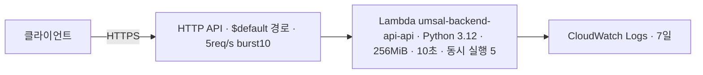

# 백엔드 API AWS 배포 (1단계)

기준일: 2026-11-05 · 이슈 #19. MVP 구현 전에 배포 경로를 검증하려고 지금 코드를 API Gateway HTTP API + Lambda로 배포했다. VPC·Aurora·DynamoDB·S3 원음·Cognito·CloudFront 연결은 이 단계에 없다.

## 구조



| 스택 | 템플릿 | 자원 |
|---|---|---|
| `umsal-backend-bootstrap` | [infra/aws/bootstrap.yaml](../infra/aws/bootstrap.yaml) | Lambda zip용 비공개 S3 버킷(암호화·HTTPS 강제·이전 버전 7일 만료, `Retain`) |
| `umsal-backend-api` | [infra/aws/api.yaml](../infra/aws/api.yaml) | HTTP API, Lambda, 실행 역할(자기 로그 쓰기만), 로그 그룹 2개, Errors 경보(알림 구독 없음) |

- 프로젝트 계정, 선택 리전 `ap-southeast-2`. umsal-pwa 스택(`umsal-pwa-demo*`, `umsal-demo-storage`)과 그 CloudFront는 건드리지 않는다.
- 직접 API 주소는 인증 없이 열려 있다. 지금 노출되는 것은 health 경로뿐이다. 업무 API를 배포하기 전에 Cognito 인증(D3)과 CloudFront `/api/*` 연결 방식을 정해야 한다.
- API 접근 로그는 요청 ID·경로 키·상태·응답 길이만 남긴다. 헤더·본문·쿼리·IP는 남기지 않는다.
- 스로틀링은 실수로 인한 비용을 줄이는 장치이며 절대 비용 상한이 아니다. Lambda 동시 실행이 5로 묶여 있어 동시 요청이 5를 넘으면 API Gateway 한도(burst 10) 안이라도 일부 요청이 5xx로 실패할 수 있다. 1단계에서는 의도한 제한이다.
- Lambda zip에는 Git이 추적하는 `src/umsal_backend` 파일만 들어간다. 무시 대상 로컬 파일(`.env` 등)은 포함하지 않는다.
- FastAPI 기본 `/docs`·`/openapi.json`도 같은 주소에서 열린다. 업무 API 배포 전(D3)에 비활성화나 보호를 정한다.

## 배포 절차

`aws login --profile ai-x-final`로 로그인한 상태에서 저장소 루트에서 실행한다. PR CI에는 AWS 권한을 주지 않으며 배포는 운영자가 직접 실행한다.

```bash
P="--profile ai-x-final --region ap-southeast-2"
# 1) artifact 버킷 (처음 한 번, 이후 변경 시만)
aws cloudformation deploy $P --stack-name umsal-backend-bootstrap \
  --template-file infra/aws/bootstrap.yaml --tags Project=umsal-backend
B=$(aws cloudformation describe-stacks $P --stack-name umsal-backend-bootstrap \
  --query 'Stacks[0].Outputs[0].OutputValue' --output text)
# 2) Linux x86_64 zip 빌드: src·pyproject.toml·uv.lock이 커밋된 상태여야 하며 이름은 HEAD SHA
python infra/aws/build_lambda.py
SHA=$(git rev-parse HEAD)
aws s3api put-object $P --bucket "$B" --key "lambda/$SHA.zip" --body ".local/lambda/$SHA.zip"
# 3) API 스택 생성/갱신
aws cloudformation deploy $P --stack-name umsal-backend-api --template-file infra/aws/api.yaml \
  --capabilities CAPABILITY_IAM --tags Project=umsal-backend \
  --parameter-overrides ArtifactBucket="$B" ArtifactKey="lambda/$SHA.zip"
```

템플릿 검사: `uvx --from cfn-lint==1.59.0 cfn-lint infra/aws/bootstrap.yaml infra/aws/api.yaml`.

## 배포 확인 기록

2026-11-05, 코드 commit `a8d36ea1881288f4ca557edf43812ab5686c5276`(zip 3,315,872바이트), 두 스택 `CREATE_COMPLETE`.

| 요청 | 결과 |
|---|---|
| `GET /health` | 200 `{"status":"ok","version":"0.1.0"}` (첫 요청 cold start 약 2.9초) |
| `GET /api/health/live` | 200 `{"status":"ok","service":"api","environment":"dev"}` |
| `GET /api/health/ready` | 503 `not_ready`, `aurora`·`dynamodb` 모두 `not_configured` (DB 미연결, 의도한 동작) |
| `GET /does-not-exist` | 404 |

직접 API 주소는 `umsal-backend-api` 스택의 `ApiEndpoint` 출력으로 확인한다.

## cfn-guard 결과와 판단

AWS IaC MCP의 cfn-guard 보안 규칙 검사에서 6건이 나왔고 다음처럼 판단했다.

| 규칙 | 판단 |
|---|---|
| S3 Object Lock·복제·접근 로그 | artifact 버킷에 과하다. 다른 리전 복제는 AGENTS의 AWS 규칙(new AWS experience: cross-Region 복제 금지)에 어긋난다 |
| S3 HTTPS 전용·공개 ACL 금지 | 거부 정책과 공개 차단 4개 설정이 이미 있다. 규칙이 기대하는 정책 형식과 달라 걸린 것으로 본다 |
| IAM inline policy | 권한이 자기 로그 쓰기뿐이고 umsal-pwa와 같은 방식이라 유지한다. 데이터 저장소 권한을 추가할 때 다시 검토한다 |

## 비용·중지·삭제

DB·NAT·VPC가 없어 소량 요청은 무료 제공량 안에 든다. 실제 청구는 AWS Settings > Billing에서 확인한다.
즉시 중지하려면 함수의 reserved concurrency를 0으로 바꾼다. 스택 삭제는 운영자가 판단해 별도로 실행한다. artifact 버킷은 `Retain`이라 스택 삭제 뒤에도 남으므로 버전까지 직접 정리해야 한다.

## 다음 단계

- 2단계: 설계 초안 [aws-stage2-design.md](aws-stage2-design.md)(Aurora express·Cognito, 비용 견적). 사용자 결정 후 생성
- CloudFront `/api/*`를 이 API로 보낼지(경로 분리 포함) umsal-pwa와 조율
