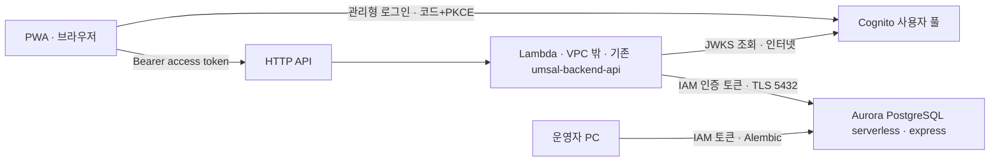

# 2단계 AWS 설계: Aurora express·Cognito (초안)

기준일: 2026-11-05 · 이슈 #38 · **설계와 견적만 담았다. AWS 자원은 만들지 않았다.** 생성은 사용자가 이 견적과 아래 결정 사항을 확인한 뒤 별도 작업에서 한다.

## 1. 목표

로컬에서 검증한 업무 API(사용자·관계·초대·동의·연결 해제, 업무 operation 8개)를 1단계 Lambda에서 실제 DB·인증과 함께 돌린다. 녹음·분석(DynamoDB·S3)은 1차 범위(D8) 결정 뒤 3단계에서 붙인다.

## 2. 권장 구성

| 구성 | 선택 | 이유 |
|---|---|---|
| DB | Aurora PostgreSQL serverless, **express configuration** ([infra/aws/database.yaml](../infra/aws/database.yaml)) | 고객 VPC가 필요 없다. AWS 관리형 internet access gateway로 접속하고 **IAM 데이터베이스 인증만** 허용한다(비밀번호 없음). 최소 0 ACU로 쉬면 자동 정지한다 |
| DB 접속 | Lambda 실행 역할에 `rds-db:connect` 권한, 접속할 때 `generate-db-auth-token`으로 15분짜리 토큰을 만들어 비밀번호 자리에 넣는다 | 토큰은 호출자가 SigV4로 **로컬에서 서명**하므로 Secrets Manager나 VPC 엔드포인트가 필요 없다 |
| 인증 | Cognito 사용자 풀(Essentials, 이메일 로그인, 관리형 로그인 v2), 비밀 없는 앱 클라이언트, 인가 코드 + PKCE ([infra/aws/auth.yaml](../infra/aws/auth.yaml)) | D3. 월 활성 사용자 1만 명까지 무료. access token 60분, refresh token 30일 |
| Lambda | 1단계 스택 그대로(VPC 밖) | Cognito JWKS 조회가 인터넷으로 바로 된다. NAT가 필요 없다 |
| 마이그레이션 | 운영자 PC에서 IAM 토큰으로 `alembic upgrade head` | VPC 안에서 돌릴 필요가 없다. 적용 전 `--sql`로 SQL을 검토한다 |

### 버린 대안: VPC + 프라이빗 Lambda (현재 SPEC 원칙)

| 항목 | VPC 방식 | express 방식 |
|---|---|---|
| VPC·서브넷·보안 그룹 | 필요 | 없음 |
| Cognito JWKS 조회 | NAT 게이트웨이(시간당 요금 + 데이터 처리 요금) 또는 JWKS를 배포 때 고정 | 인터넷으로 직접 |
| Secrets Manager | IAM 인증을 쓰면 피할 수 있음(SPEC 원칙) | 필요 없음(IAM 인증만 가능) |
| 마이그레이션 실행 위치 | VPC 안(별도 Lambda나 bastion) | 운영자 PC |
| DynamoDB·S3(3단계) | 게이트웨이 엔드포인트(무료) | Lambda가 VPC 밖이라 공용 엔드포인트로 접근(추가 비용 없음) |
| 네트워크 격리 | DB가 VPC 안에만 있음 | DB 엔드포인트가 인터넷에서 보이지만 IAM 토큰 + TLS 없이는 접속할 수 없다 |

**결정 필요(사용자):** SPEC "실행" 표의 "Lambda는 전용 VPC의 프라이빗 서브넷에서 실행한다"와 "VPC 구성 원칙"(#7 결정)을 express 방식으로 바꿀지. 이 PR은 SPEC 원칙을 바꾸지 않았다. 승인하면 SPEC과 AGENTS의 AWS 대상 서비스 표를 같은 PR에서 고친다.

## 3. 비용 견적 (ap-southeast-2)

단가는 2026-11-05 AWS Price List API(`aws pricing get-products`)로 조회했다.

| 항목 | 단가 | 가정 | 월 예상 |
|---|---|---|---|
| Aurora Serverless v2 | USD 0.20 / ACU-시간 | 최소 0 ACU, 5분 무활동 시 정지, 개발·시연 하루 2~4시간 × 평균 1 ACU | USD 12~24 |
| Aurora 저장 공간 | USD 0.11 / GB-월 | 1 GB 이하(Free 플랜 상한 1 GiB) | 약 0.11 |
| Aurora I/O | USD 0.22 / 100만 요청 | 소량 | 1 미만 |
| Cognito | 월 1만 MAU 무료 | 소수 체험 | 0 |
| Lambda·API Gateway·CloudWatch Logs | 무료 제공량 | 소량, 로그 7일 | 약 0 |
| **합계** | | | **약 USD 12~25** |

- 남은 크레딧 USD 119.96(2027-04-30 만료) 기준으로 이 사용량이면 약 5~9개월이다.
- **최소 용량을 0.5 ACU 이상으로 두면 자동 정지가 꺼져** 쉬는 동안에도 과금된다(0.5 ACU × 720시간 × 0.20 = 월 약 USD 72). 발표 직전에만 올리고 끝나면 0으로 되돌린다(SPEC VPC 원칙 마지막 항목과 같은 취지).
- 이 표는 견적이며 실제 청구는 AWS Settings > Billing에서 확인한다.

### Free 플랜 제약

- Aurora PostgreSQL serverless는 **클러스터당 최대 4 ACU, 저장 공간 1 GiB**까지다(Paid 플랜 전환 시 해제). MVP의 사용자·관계·동의·멱등 기록에는 충분하지만, 녹음 메타데이터와 작업 상태가 쌓이면 다시 본다.
- express는 고객 관리형 KMS 키, 엔진 버전 지정, 사용자 정의 파라미터 그룹(생성 시), RDS Proxy, Blue/Green 배포를 지원하지 않는다.

## 4. 코드 변경 목록 (구현 PR에서)

1. **IAM 토큰 접속**: `db.connect`가 `DATABASE_URL` 대신(또는 함께) `DB_HOST`·`DB_USER`·`DB_NAME`·리전으로 `rds.generate_db_auth_token`을 호출해 비밀번호로 쓰고 `sslmode=require`로 접속한다. 토큰은 15분 유효이므로 연결마다 새로 만든다. 로컬은 지금처럼 `DATABASE_URL`을 유지한다.
2. **자동 정지 재개 지연**: 정지된 클러스터는 첫 연결에서 재개되며 수 초 이상 걸릴 수 있다. 현재 연결 제한 3초로는 503이 난다. 선택지: 연결 제한을 Lambda 제한(10초) 안에서 늘림, 또는 503 `retryable=true`를 그대로 두고 PWA가 재시도. 구현 PR에서 실측 후 정한다.
3. **앱 DB 사용자**: 마스터 사용자(`postgres`) 대신 앱 전용 사용자를 만들고 `rds_iam` 역할과 필요한 권한만 준다. 마이그레이션은 운영자가 별도 사용자로 실행한다.
4. **Lambda 설정**: `api.yaml`에 `COGNITO_USER_POOL_ID`·`COGNITO_APP_CLIENT_IDS`·DB 접속 환경 변수와 `rds-db:connect` 권한(`arn:aws:rds-db:<region>:<account>:dbuser:<cluster-resource-id>/<db-user>`)을 추가한다.
5. **ready 확인**: `checks.aurora`가 같은 IAM 접속을 쓴다. DynamoDB는 3단계까지 `not_configured`라 전체 ready는 계속 503이다.
6. **정리 작업 주기 실행**: `maintenance.scheduled_handler`를 EventBridge Scheduler로 하루 1회 호출한다(#36).
7. **CloudFront 연결**: PWA CloudFront의 `/api/*`를 이 API로 보낼지, `/api/push/*`만 PWA 푸시 Lambda에 남길지 umsal-pwa와 정한다.

## 5. 배포 순서 초안

1. `umsal-backend-auth` 스택(Cognito) 생성 → 출력값(사용자 풀 ID·클라이언트 ID)을 PWA와 공유
2. `umsal-backend-database` 스택(Aurora express) 생성 → `ServerlessV2ScalingConfiguration`이 express와 함께 받아들여지는지 확인(거부되면 템플릿에서 빼고 `modify-db-cluster`로 같은 값 적용)
3. 운영자가 IAM 토큰으로 접속해 앱 사용자 생성, `alembic upgrade head`
4. 구현 PR의 코드로 Lambda 재배포(환경 변수·권한 추가) → `/api/health/ready`의 `aurora: ok`, 합성 계정으로 `/api/me` 확인
5. 정리 작업 스케줄 연결

모든 생성 단계는 실행 전에 사용자 확인을 받는다. 삭제는 사용자가 직접 판단한다(DB는 `DeletionProtection`과 `DeletionPolicy: Snapshot`, 사용자 풀은 `DeletionProtection`과 `Retain`).

## 6. 검증 상태

- `infra/aws/database.yaml`·`auth.yaml`: cfn-lint 1.59.0 통과. 단, cfn-lint 스키마에 `WithExpressConfiguration`이 없어 이 리소스의 E3002만 무시했고, ap-southeast-2의 실제 CloudFormation 리소스 스키마(`aws cloudformation describe-type`)에 해당 속성(boolean, 생성 시만 지정)이 있음을 확인했다.
- 실제 생성·배포·접속은 하지 않았다. express의 기본 엔진 버전·ACU 기본값·재개 지연은 생성 때 확인한다.

## 근거

- [Aurora PostgreSQL express configuration](https://docs.aws.amazon.com/AmazonRDS/latest/AuroraUserGuide/CHAP_GettingStartedAurora.AuroraPostgreSQL.ExpressConfig.html)
- [Aurora Serverless v2 scale to zero](https://aws.amazon.com/blogs/database/introducing-scaling-to-0-capacity-with-amazon-aurora-serverless-v2/)
- [IAM database authentication](https://docs.aws.amazon.com/AmazonRDS/latest/AuroraUserGuide/UsingWithRDS.IAMDBAuth.html)
- [AWS::RDS::DBCluster `WithExpressConfiguration`](https://docs.aws.amazon.com/AWSCloudFormation/latest/TemplateReference/aws-resource-rds-dbcluster.html)
- [Free plan supported services](https://docs.aws.amazon.com/accounts/latest/reference/supported-services-sign-up-new.html), [Aurora Free plan limits](https://docs.aws.amazon.com/rds/latest/auroraextendedcontent/aurora-features-cost-effective.html)
