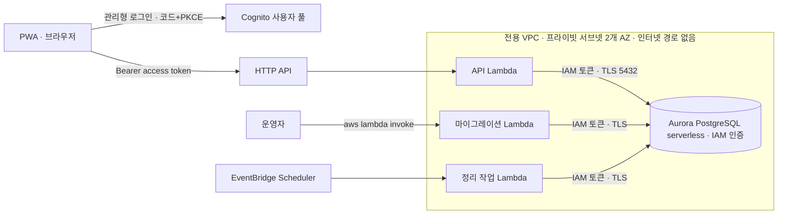

# 2단계 AWS 설계: VPC·Aurora·Cognito

기준일: 2026-11-05 · 이슈 #38(초안), #40(VPC 확정) · **설계와 견적만 담았다. AWS 자원은 만들지 않았다.** 생성은 사용자가 확인한 뒤 별도 작업에서 한다.

**결정(2026-11-05, 사용자):** SPEC의 기존 원칙대로 **VPC 방식**을 쓴다. Lambda와 Aurora를 전용 VPC의 프라이빗 서브넷에 둔다. #38에서 제안한 Aurora express configuration(VPC 없음)은 네트워크 방어선이 IAM 한 겹뿐이라 채택하지 않았다(아래 "버린 대안").

## 1. 목표

로컬에서 검증한 업무 API(사용자·관계·초대·동의·연결 해제, 업무 operation 8개)를 실제 DB·인증과 함께 AWS에서 돌린다. 녹음·분석(DynamoDB·S3)은 1차 범위(D8) 결정 뒤 3단계에서 붙인다.

## 2. 구성

| 구성 | 선택 | 이유 |
|---|---|---|
| 네트워크 ([network.yaml](../infra/aws/network.yaml)) | VPC, 2개 AZ 프라이빗 서브넷, 인터넷 게이트웨이·NAT 없음, S3·DynamoDB 게이트웨이 엔드포인트(무료), Lambda용·DB용 보안 그룹 | SPEC VPC 원칙. DB는 Lambda 보안 그룹에서 오는 5432만 받는다. 서브넷에 인터넷 경로가 없다 |
| DB ([database.yaml](../infra/aws/database.yaml)) | Aurora PostgreSQL 17.11 serverless(로컬 Docker와 같은 버전), writer 1대(`db.serverless`), 0~4 ACU, 5분 무활동 시 자동 정지, 저장 암호화, 공개 접근 없음, 삭제 보호·삭제 시 스냅샷 | 최소 0 ACU 지원 확인(2026-11-05 `describe-db-engine-versions`). Free 플랜 상한 4 ACU |
| DB 접속 | IAM 데이터베이스 인증. Lambda가 `generate_db_auth_token`으로 15분 토큰을 로컬 서명 | Secrets Manager 인터페이스 엔드포인트가 필요 없다(SPEC 원칙). 관리형 마스터 비밀번호는 비상용으로만 둔다 |
| 인증 ([auth.yaml](../infra/aws/auth.yaml)) | Cognito 사용자 풀(Essentials, 이메일, 관리형 로그인 v2), 비밀 없는 앱 클라이언트, 인가 코드 + PKCE | D3. 월 1만 MAU 무료 |
| Cognito 서명 키(JWKS) | **배포할 때 JWKS를 받아 Lambda 설정에 고정**한다. Lambda는 실행 중에 JWKS를 조회하지 않는다 | VPC 안 Lambda는 인터넷에 나갈 수 없다. NAT(월 약 USD 46) 대신 AWS 권장대로 공개 키를 캐시한다. 키 교체는 드물고, 교체 시 재배포한다 |
| 마이그레이션 | VPC 안 **마이그레이션 전용 Lambda**를 운영자가 `aws lambda invoke`로 실행 | 운영자 PC는 프라이빗 DB에 닿지 않는다. bastion·SSM은 인스턴스나 인터페이스 엔드포인트 비용이 든다 |
| 첫 DB 사용자 생성(1회) | **RDS Data API**를 잠시 켜고 운영자 PC에서 `aws rds-data execute-statement`(관리형 마스터 비밀번호의 Secrets Manager ARN)로 앱·마이그레이션 사용자를 만든 뒤 Data API를 끈다 | 사용자를 만들기 전에는 IAM 접속이 불가능하고, VPC 안 Lambda는 Secrets Manager에 닿지 않는다(닭과 달걀). Data API는 서비스 측 HTTPS 호출이라 VPC 접근이 필요 없다. 템플릿 파라미터 `EnableDataApi`(기본 `false`) |
| 정리 작업 | `maintenance.scheduled_handler`를 VPC 안 Lambda로 두고 EventBridge Scheduler가 하루 1회 호출 | #36 |

### 보안 요구사항

- **TLS 검증**: `sslmode=verify-full`과 RDS 글로벌 CA 번들(Lambda 패키지에 포함)로 서버 인증서를 검증한다. 서버 쪽도 클러스터 파라미터 `rds.force_ssl=1`로 암호화되지 않은 연결을 거부한다.
- **Data API는 꺼 둔다**: 첫 사용자 생성 때만 켜고 끝나면 끈다. 켜져 있는 동안은 마스터 비밀번호 비밀에 접근할 수 있는 IAM 주체가 SQL을 실행할 수 있는 별도 경로가 된다.
- **`rds-db:connect` 최소 권한**: API·정리 작업 Lambda는 앱 사용자 하나(`dbuser:<cluster-resource-id>/<app-user>`)에만, 마이그레이션 Lambda는 마이그레이션 사용자 하나에만 허용한다. `dbuser:*`는 쓰지 않는다. 앱 사용자에게 DDL 권한을 주지 않는다. 마스터 사용자는 코드가 쓰지 않는다.
- **마이그레이션 Lambda 호출 권한**은 운영자 역할에만 준다. 이 Lambda는 API Gateway에 연결하지 않는다.
- **합성 데이터만**: 보관·삭제 정책(umsal-pwa #19)이 정해지기 전에는 실제 사용자 자료를 넣지 않는다.

### 결정 필요(사용자)

- **Cognito 자가 가입**: 초안(`auth.yaml`)은 누구나 이메일로 가입할 수 있다. 가족 음성 자료를 다루므로 초대받은 사람만 가입하게 하려면 `AdminCreateUserConfig.AllowAdminCreateUserOnly`를 켜고 가입 경로를 따로 만들어야 한다.

## 3. 비용 견적 (ap-southeast-2)

단가는 2026-11-05 AWS Price List API(`aws pricing get-products`)로 조회했다.

| 항목 | 단가 | 가정 | 월 예상 |
|---|---|---|---|
| Aurora Serverless v2 | USD 0.20 / ACU-시간 | 최소 0 ACU, 5분 무활동 시 정지, 개발·시연 하루 2~4시간 × 평균 1 ACU | USD 12~24 |
| Aurora 저장 공간 | USD 0.11 / GB-월 | 1 GB 이하(Free 플랜 상한 1 GiB) | 약 0.11 |
| Aurora I/O | USD 0.22 / 100만 요청 | 소량 | 1 미만 |
| 백업 | 보존 1일 | 클러스터 크기 이내는 무료 범위 | 약 0 |
| VPC·서브넷·보안 그룹·게이트웨이 엔드포인트 | 무료 | | 0 |
| 관리형 마스터 비밀번호(Secrets Manager 비밀 1개) | 비밀당 월 요금 | 비상용 1개 | 1 미만 |
| Cognito | 월 1만 MAU 무료 | 소수 체험 | 0 |
| Lambda·API Gateway·CloudWatch Logs·Scheduler | 무료 제공량 | 소량 | 약 0 |
| **합계** | | | **약 USD 13~26** |

**쓰지 않는 것과 그 비용**(쓰면 위 합계에 더해진다):

| 항목 | 단가 | 월 비용 |
|---|---|---|
| NAT 게이트웨이 | USD 0.059/시간 + 0.059/GB + 공인 IPv4 0.005/시간 | 약 USD 46 이상 |
| 인터페이스 VPC 엔드포인트 | USD 0.013/시간/AZ (+ 0.01/GB) | 서비스 1개·2개 AZ 약 USD 19 |
| Aurora 최소 0.5 ACU 상시 | 0.5 × 720시간 × 0.20 | 약 USD 72 |

- 남은 크레딧 USD 119.96으로는 이 사용량에서 약 5~9개월치지만, 크레딧은 2027-04-30(약 6개월 뒤)에 만료된다.
- 발표 직전에만 최소 용량을 올려 재개 지연을 없애고, 끝나면 0으로 되돌린다(SPEC VPC 원칙 마지막 항목).
- 실제 청구는 AWS Settings > Billing에서 확인한다.

### Free 플랜 제약

- Aurora PostgreSQL serverless는 클러스터당 **최대 4 ACU, 저장 공간 1 GiB**까지다(Paid 플랜 전환 시 해제). 녹음 메타데이터와 작업 상태가 쌓이는 3단계에서 다시 본다.

## 4. 코드 변경 목록 (구현 PR에서)

1. **IAM 토큰 접속**: `db.connect`가 `DB_HOST`·`DB_USER`·`DB_NAME`·리전으로 `rds.generate_db_auth_token`을 호출해 비밀번호로 쓰고 `sslmode=verify-full`로 접속한다. 토큰은 약 10분 캐시하고, IAM 인증의 신규 연결 속도 한도를 연결 수와 함께 본다. 로컬은 지금처럼 `DATABASE_URL`을 유지한다. `db.py` docstring의 "Secrets Manager 주입" 서술을 고친다.
2. **JWKS 정적 로딩**: `auth.py`에 이미 있는 키 해석기 주입을 써서, 환경 변수(또는 배포 패키지 파일)로 받은 JWKS에서 `kid`로 키를 찾는다. 배포 스크립트가 배포 때 `https://cognito-idp.<region>.amazonaws.com/<pool>/.well-known/jwks.json` **문서 전체**(보통 키 2개)를 받아 넣는다. 알 수 없는 `kid`는 401이고 실행 중 재조회는 하지 않는다. **정적 JWKS 설정이 없을 때 URL 조회 해석기로 조용히 되돌아가지 않는다**(VPC 안에서는 모든 요청이 503이 되므로, 설정 누락은 시작 시 오류로 드러나게 한다).
3. **자동 정지 재개 지연**: 정지된 클러스터의 첫 연결은 수 초 이상 걸릴 수 있어 현재 연결 제한 3초로는 503이 난다. 연결 제한을 Lambda 제한(10초) 안에서 늘리거나 503 `retryable=true`로 PWA가 재시도하게 한다. 생성 후 실측해 정한다.
   - **연결을 열어 두지 않는다**: 따뜻한 Lambda 컨테이너가 DB 연결을 유지하면 클러스터가 정지하지 못해 비용 견적이 틀어진다. 지금처럼 요청마다 연결을 닫거나, 재사용한다면 짧은 유휴 시간 뒤 닫는다. 하루 1회 정리 작업은 클러스터를 잠깐 깨우지만 비용은 미미하다.
4. **앱·마이그레이션 DB 사용자**: 마이그레이션 Lambda가 처음 실행될 때(또는 운영자 절차로) 앱 사용자와 마이그레이션 사용자를 만들고 `rds_iam` 역할과 필요한 권한만 준다.
5. **마이그레이션 Lambda**: Alembic과 `migrations/`를 담는 별도 패키지(현재 Alembic은 개발 의존성이라 API zip에 없다), 핸들러는 `upgrade head`만 수행하고 결과 revision만 로그에 남긴다.
6. **Lambda 설정**(`api.yaml`): `VpcConfig`(프라이빗 서브넷·Lambda 보안 그룹), `COGNITO_*`·DB 환경 변수, 실행 역할에 `rds-db:connect`와 VPC ENI 권한(`AWSLambdaVPCAccessExecutionRole` 상당의 최소 권한).
7. **ready 확인**: `checks.aurora`가 같은 IAM 접속을 쓴다. DynamoDB는 3단계까지 `not_configured`라 전체 ready는 계속 503이다.
8. **CloudFront 연결**: PWA CloudFront의 `/api/*`를 이 API로 보낼지, `/api/push/*`만 PWA 푸시 Lambda에 남길지 umsal-pwa와 정한다.

## 5. 배포 순서 초안

1. `umsal-backend-auth`(Cognito) 생성 → 사용자 풀 ID·클라이언트 ID를 PWA와 공유, 콜백 경로 합의
2. `umsal-backend-network`(VPC) 생성
3. `umsal-backend-database`(Aurora) 생성 — 네트워크 출력값(서브넷·DB 보안 그룹)을 파라미터로 전달. 생성 전 change set으로 확인
4. `EnableDataApi=true`로 스택을 갱신 → 운영자 PC에서 `aws rds-data execute-statement`로 앱·마이그레이션 사용자 생성(`CREATE USER …; GRANT rds_iam TO …`, 앱 사용자는 DDL 없음) → `EnableDataApi=false`로 되돌림
5. 구현 PR의 코드로 마이그레이션 Lambda 배포·실행(`upgrade head`)
6. API Lambda를 VPC·환경 변수·권한과 함께 재배포 → `/api/health/ready`의 `aurora: ok`, 합성 계정으로 `/api/me` 확인
7. 정리 작업 Lambda와 스케줄 연결

모든 생성 단계는 실행 전에 사용자 확인을 받는다. 삭제는 사용자가 직접 판단한다.

### 운영 런북: Cognito 키 교체

JWKS를 배포 때 고정하므로 Cognito가 서명 키를 바꾸면 **새 키로 서명된 모든 토큰이 401**이 되고, 재배포 전까지 복구되지 않는다(안전한 쪽으로 실패하지만 서비스는 멈춘다). 교체 주기는 공개되어 있지 않다.

- **감지**: VPC 밖의 작은 정기 점검(예: 하루 1회 Scheduler → VPC 밖 Lambda, 또는 운영자 스크립트)이 공개 JWKS의 `kid` 목록을 배포된 값과 비교해 다르면 알린다. API의 401 비율 급증에도 CloudWatch 경보를 둔다.
- **복구**: 배포 스크립트로 JWKS를 다시 받아 API Lambda를 재배포한다(코드 변경 없음).

## 6. 검증 상태

- `infra/aws/network.yaml`·`database.yaml`·`auth.yaml`: cfn-lint 1.59.0 통과. 실제 생성·배포·접속은 하지 않았다.
- Aurora PostgreSQL 17.11의 최소 0 ACU 지원은 `aws rds describe-db-engine-versions`(읽기 전용)로 확인했다.

## 7. 버린 대안: Aurora express configuration (#38 초안)

express는 고객 VPC 없이 AWS 관리형 internet access gateway와 IAM 인증만으로 접속하는 구성이다. NAT·엔드포인트가 필요 없고 마이그레이션을 운영자 PC에서 할 수 있지만, DB 엔드포인트가 인터넷에 보이고 보안 그룹·IP 제한 같은 네트워크 계층 통제가 없어 방어선이 IAM 인증 + TLS 한 겹뿐이다. VPC 방식도 JWKS 고정 배포와 IAM 인증으로 같은 수준의 비용(월 약 USD 13~26)에 맞출 수 있어 VPC를 택했다.

## 근거

- [Aurora Serverless v2 scale to zero](https://aws.amazon.com/blogs/database/introducing-scaling-to-0-capacity-with-amazon-aurora-serverless-v2/)
- [IAM database authentication](https://docs.aws.amazon.com/AmazonRDS/latest/AuroraUserGuide/UsingWithRDS.IAMDBAuth.html)
- [Cognito JWT 검증과 공개 키 캐시](https://repost.aws/knowledge-center/decode-verify-cognito-json-token)
- [Lambda in a VPC](https://docs.aws.amazon.com/lambda/latest/dg/configuration-vpc.html)
- [Free plan supported services](https://docs.aws.amazon.com/accounts/latest/reference/supported-services-sign-up-new.html), [Aurora Free plan limits](https://docs.aws.amazon.com/rds/latest/auroraextendedcontent/aurora-features-cost-effective.html)
