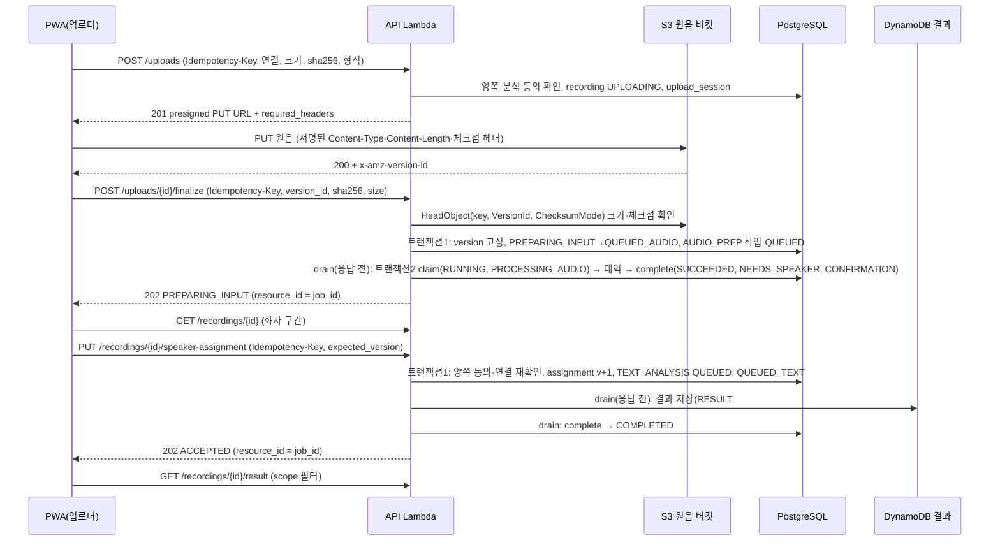

# MVP 녹음·분석 흐름 설계 (D8, #68)

기준일: 2026-11-09 · 상태: 12절 3단계(#72)·4단계(#75) 구현, 5단계(삭제·정리) 구현 전. 결정 근거는 [API 계약 정합성](api-contract.md) D8, 데이터 설계 원본은 umsal-pwa `docs/design/09_API_계약_및_데이터설계.md`, 요청·응답 형태는 [contracts/openapi.yaml](../contracts/openapi.yaml)이다.

## 1. 범위 (D8 확정)

사용자 결정(2026-11-08): **음성 파일 1건 업로드 → 분석(처음엔 대역) → 본인 결과 확인 → 동의한 가족에게 공유 → 삭제**를 1차 범위로 한다. 분석 자리는 실제 모델 worker로 바꿀 수 있게 비워 둔다.

| 구분 | operation |
|---|---|
| 1차 구현(9개) | `createUpload`, `finalizeUpload`, `getJob`, `listRecordings`, `getRecording`, `assignSpeaker`, `getResult`, `deleteRecording`, `getDeletionStatus` |
| 2차로 미룸 | `retryJob`, `requestBulkDeletion`, `submitFeedback`, `getWeeklyReport`, `getSettings`·`updateSettings`, worker 4개(`claim`·`heartbeat`·`complete`·`fail`), `registerDevice`·`unregisterDevice`(D4) |

계약에서 operation을 지우지 않는다. 2차 operation은 라우팅하지 않는다(FastAPI 기본 404). `tests/test_contract_parity.py`는 구현된 operation만 비교한다.

## 2. 흐름

## 3. 대역 분석과 교체 자리

- **작업 두 단계 유지(검토 B2):** 쓰기 요청의 트랜잭션1은 작업을 `QUEUED`로 커밋하고 녹음을 `QUEUED_AUDIO`/`QUEUED_TEXT`로 옮긴다(멱등 응답도 이때 저장). 그다음 **응답을 돌려주기 전, 같은 Lambda 호출 안에서**(Lambda는 응답 뒤 작업을 보장하지 않는다) `drain(job_id)`가 트랜잭션2로 claim(`RUNNING`, `PROCESSING_*`, attempt+1) → `Analyzer` 실행 → 내부 `complete()`/`fail()`을 부른다. `complete()`·`fail()`은 2차의 worker API가 그대로 쓸 함수다. 실제 worker로 바꿀 때는 요청 안의 `drain()` 호출을 빼고 worker API(claim·heartbeat·complete·fail)를 붙이며, 상태 전이 코드는 이미 대역으로 실행·시험된 상태다. `drain()`의 오류는 잡아서 기록한다. `AnalysisError(retryable=True)`와 S3·DynamoDB 일시 오류는 작업을 `QUEUED`로 되돌리고(attempt는 센 채로), `retryable=False`이거나 attempt가 3을 넘으면 `FAILED`(종료)로 바꾼다. 어느 경우든 **이미 커밋한 202를 500으로 바꾸지 않는다**(저장된 멱등 응답과 실제 상태가 어긋나지 않게). 대역 실행 시간은 finalize·assign 응답 시간에 포함된다.
- **멈춘 작업 복구(lease):** claim은 `lease_expires_at = now() + 2분`을 함께 쓴다. `drain()` 전에 Lambda가 끝나면 작업이 `QUEUED`로, claim 뒤 끝나면 `RUNNING`(lease 만료)으로 남는다. `getJob`·`getRecording`이 30초 넘은 `QUEUED`나 lease가 지난 `RUNNING` 작업을 보면 그 요청에서 다시 claim한다(`UPDATE ... WHERE status = 'QUEUED' OR (status = 'RUNNING' AND lease_expires_at < now())`, 한 번만 성공). attempt는 claim마다 1씩 늘며 첫 claim이 1이다. attempt가 3을 넘으면(세 번째 재claim 뒤에도 실패) `FAILED`. 읽기 요청은 이 재실행이 실패해도 현재 상태를 그대로 돌려준다. 아무도 조회하지 않을 때를 위해 정리 작업을 15분마다 돌린다(jobs 스택에 일정 추가).
- `umsal_backend/analysis.py`의 `Analyzer` 프로토콜: `prepare_audio(recording) -> AudioPrepResult`, `analyze_text(recording, assignment) -> TextResult`. 실패는 `AnalysisError(code, retryable)`로 올려 같은 `fail()` 경로를 탄다. 1차는 `StubAnalyzer`만 구현하며 **원음 내용을 읽지 않는다.**
- 대역 출력: 화자 구간 `spk_1` 0~5,000ms·`spk_2` 5,000~10,000ms(계약 ID 패턴·`start_ms >= 0`·`end_ms >= 1` 만족). TEXT 결과는 고정 예시(`status: OBSERVED`, 인용 없는 요약 1문장, 관찰 1개 `WORRY`, 근거 발화 1개)이며 **항상 `demo: true`**, `limitations`에 "대역 분석 결과예요. 실제 음성을 분석하지 않았고, 파일이 음성인지도 확인하지 않았어요."를 넣는다. 요청의 `demo` 필드는 저장만 하고 동작을 바꾸지 않는다. umsal-pwa #17 완료 조건(GPU·예산 미정 상태를 즉시 분석 가능으로 표시하지 않음)을 지킨다.
- `UNSURE` 선택: `speaker_assignments` 행을 남기고 version을 올리지만(계약 `expected_version`), TEXT 작업은 만들지 않고 녹음을 `ABSTAINED`로 끝낸다. 이미 `ABSTAINED`인 녹음에 같은 키로 다시 보내면 재전송 응답이다. `getResult`는 200 `status: ABSTAINED`, 빈 `scope`·관찰, `demo: true`, 보류 사유 `limitations`를 준다(409로 영원히 남기지 않는다).
- 대안(채택 안 함): 단일 트랜잭션 동기 실행(상태를 건너뛰어 worker 경로가 시험되지 않음), jobs Lambda 비동기 호출·SQS(발표용 1건 흐름에 구성 요소와 실패 지점만 늘어남).

## 4. 응답 필드 (계약 필수값)

| 필드 | 1차 값 |
|---|---|
| `Recording.availability`·`Job.availability` | `worker_availability: UNKNOWN`, `next_processing_at: null`(`RUNNING`은 GPU 가용으로 읽히고 `OFF`는 처리 안 함으로 읽혀 쓰지 않는다) |
| `raw_available` / `raw_expires_at` | `false` / `null`(원음 다운로드 경로 없음, 업로더는 로컬 파일을 가짐) |
| `expires_at` | `null`(보관 기간 미정, umsal-pwa #19) |
| `job_id` | `UPLOADING`에서는 `null`, 이후 현재 작업 |
| `transcript_preview` | 생략(전사 없음) |
| `UploadTicket.declared_limits` | `max_bytes: 52428800`, `max_duration_seconds: 600`, `status: PROPOSED_LIMITS`. 길이는 대역 단계에서 검사하지 못한다 |
| `Accepted`(finalize·assign) | `resource_id` = 새 작업 ID. finalize `status: PREPARING_INPUT`, assign `status: ACCEPTED` |
| 413·415 | 계약에 본문 스키마가 없어도 공통 `Error` 본문으로 답한다 |

`getJob`은 연결 참여자만 조회한다. 상대 참여자에게도 상태 필드만 있고 내용은 없다.

## 5. 데이터 모델 (마이그레이션 `0006`)

| 테이블 | 주요 열·제약 |
|---|---|
| `recordings` | id(`rec_`), connection_id FK, uploader_id FK, participant_a_id·participant_b_id(연결의 두 사용자, 생성 시 복사), occurred_at, filename, content_type, size_bytes CHECK 1~52428800, sha256 CHECK `^[a-f0-9]{64}$`, s3_key, s3_version_id, status CHECK(계약 enum 12개), failure_code, speaker_assignment_version(0부터), speaker_intervals jsonb, current_job_id, deleted_at, created_at, updated_at. 색인: `(connection_id, occurred_at DESC) WHERE deleted_at IS NULL`, `(uploader_id)` |
| `upload_sessions` | id(`upl_`), recording_id UNIQUE FK, owner_id, expires_at, finalized_at. 색인 `(expires_at) WHERE finalized_at IS NULL` |
| `analysis_jobs` | id(`job_`), recording_id FK, stage, status CHECK(계약 enum), attempt, lease_expires_at, pipeline_version(`stub-1`), assignment_version, failure_code, created_at, updated_at. UNIQUE `(recording_id, stage, assignment_version, pipeline_version)`(2차 `retryJob`은 attempt를 따로 센다). 색인 `(status, created_at) WHERE status IN ('QUEUED', 'RUNNING')` |
| `speaker_assignments` | PK(recording_id, version), target_subject_id FK, speaker_id, decision, confirmed_by, confirmed_at |
| `deletion_jobs` | id(`del_`), scope(`RECORDING`만, 나머지 enum은 2차), recording_id UNIQUE, requested_by, live_deletion_status, live_deleted_at, last_error_code, attempts, next_attempt_at, sweep_after(업로드 URL 만료 뒤 재정리 시각), created_at |

상태 전이(가드: `UPDATE ... WHERE status = ANY(허용 이전 상태)`, 0행이면 409):

| 이전 | 다음 | 계기 |
|---|---|---|
| UPLOADING | PREPARING_INPUT → QUEUED_AUDIO | finalize 트랜잭션1 |
| UPLOADING | EXPIRED | 업로드 만료 정리 |
| QUEUED_AUDIO | PROCESSING_AUDIO → NEEDS_SPEAKER_CONFIRMATION | drain(AUDIO_PREP) |
| NEEDS_SPEAKER_CONFIRMATION·COMPLETED·ABSTAINED | QUEUED_TEXT | assign CONFIRMED(재지정 시 이전 작업 CANCELLED) |
| NEEDS_SPEAKER_CONFIRMATION·COMPLETED | ABSTAINED | assign UNSURE |
| QUEUED_TEXT | PROCESSING_TEXT → COMPLETED | drain(TEXT_ANALYSIS) |
| PROCESSING_* (작업 RUNNING, lease 만료) | PROCESSING_* 그대로, 작업을 그 자리에서 재claim(새 lease, attempt+1) | 조회·정리 작업의 재실행 |
| QUEUED_*·PROCESSING_* | FAILED | `fail()` 또는 attempt 3 초과(1차에서 종료 상태) |

결과 본문은 DynamoDB `pk = REC#<recording_id>`, `sk = RESULT#<assignment_version>`에 둔다. 공개 여부는 PostgreSQL의 동의·삭제·현재 assignment version으로만 정한다(storage.yaml 원칙).

## 6. 쓰기 규칙

- **멱등 키(검토 B1):** `createUpload`·`finalizeUpload`·`assignSpeaker`·`deleteRecording`은 계약대로 `Idempotency-Key`가 필수이며 기존 `idempotency.py`(`run_idempotent`, actor+route 범위)를 쓴다. 같은 키 재전송은 처음 응답(201 ticket·202 Accepted·202 DeletionAccepted)을 그대로 돌려주고, 녹음·presigned URL·작업을 새로 만들지 않는다. 삭제 뒤 재전송도 404가 아니라 처음 응답이다. 같은 키·다른 요청은 409.
- **잠금과 삭제 확인(B3):** finalize·assign·drain의 결과 반영은 `recordings` 행을 `SELECT ... FOR UPDATE`로 잠그고 `deleted_at IS NULL`을 확인한다. 삭제된 행이면 작업을 `CANCELLED`로 끝낸다.
- **저장소 간 순서(B3):** drain(TEXT)은 DynamoDB 쓰기 직전에 행을 잠가 `deleted_at`을 확인하고, DynamoDB에 결과를 쓴 뒤(같은 키 덮어쓰기라 재실행 안전, 아직 비공개) PostgreSQL에 `COMPLETED`를 커밋한다. 커밋 때 잠근 행이 그사이 삭제됐으면 **자기가 쓴 DynamoDB 항목을 지우고** 작업을 `CANCELLED`로 끝낸다. 그래도 남는 고아 항목은 아래 삭제의 두 번째 정리가 DynamoDB까지 다시 확인해 지운다.
- **동시 업로드 한도:** 사용자당 `finalized_at IS NULL AND expires_at > now()`인 세션 3개, 넘으면 429.
- **멱등 재전송과 presigned URL:** `idempotency.py`는 응답 본문을 저장하므로 `createUpload` 재전송은 저장된 본문 대신 **같은 키·헤더로 URL만 새로 서명해** 돌려준다(의도한 예외). 저장 본문에는 URL을 넣지 않는다(소지자 자격 증명을 DB에 남기지 않음).

## 7. 권한·공개 규칙

용어: grant는 방향별(`subject` → `recipient`) 행이다(`consents.py`). "양쪽 분석 동의"는 두 방향 모두 `analysis_allowed`.

- `createUpload`: 요청자가 연결 참여자, 연결 ACTIVE, **양쪽 분석 동의**. 아니면 403. `participants_permission_confirmed`는 스키마상 `const true`(false는 422). 크기 초과 413, 형식 enum 밖 415.
- `finalizeUpload`: 세션 주인만(아니면 404). 만료 409, 이미 finalize된 세션에 같은 키는 재전송 응답·다른 키는 409, sha256·크기 불일치나 version 없음은 422. 현재 연결·동의를 다시 확인(없으면 403).
- `assignSpeaker`: **업로더만**(계약 설명은 "참여자"이나 화자 확인 자료가 업로더의 로컬 원본이라 1차에서 의도적으로 좁힌다). `target_subject_id`는 연결 참여자, `speaker_id`는 이 녹음 화자 구간의 ID. 그 시점에 **양쪽 분석 동의와 연결 ACTIVE**를 다시 확인하고, `expected_version`이 현재 값과 다르면 409. 버전 증가는 `UPDATE recordings SET speaker_assignment_version = v + 1 WHERE ... AND speaker_assignment_version = expected`.
- `getResult`:
  - 결과 주체 = **현재 assignment version의 `target_subject_id`**(업로더가 아님).
  - 대상자 본인: 전체 scope.
  - 다른 참여자: grant(`subject = 대상자`, `recipient = 조회자`)의 `sharing_scopes`만. 비어 있으면 403(목록으로 이미 존재를 아는 참여자라 404로 숨기지 않는다). 대상자의 분석 동의가 꺼졌거나 연결이 ACTIVE가 아니면 대상자 본인 외에는 403.
  - scope → 필드: `summary` → `summary`, `repetition` → `observations[].category`(근거 없이), `evidence` → `observations[].evidence`. `evidence`가 없으면 근거 배열을 빼고, 요약에 인용을 넣지 않는다(계약). 구현(#75)은 이때 요약에서 따옴표로 묶인 구간(`"`·`'`·`“”`·`‘’`·`「」`·`『』`), 발화 ID(`utt_…`), 시각(`12:30`·`12:30:05`)을 지운다. 시험에는 따옴표가 든 대역 요약도 넣어 새지 않는지 확인한다.
  - 비참여자·삭제된 녹음 404, 결과 전 409 `RESULT_NOT_READY`(계약 S5). 이전 assignment version의 결과는 보여 주지 않는다. 매 조회 때 현재 동의·연결을 다시 거른다. 구현(#75): 처리 중이면 `retryable: true`, `FAILED`·`CANCELLED`·`EXPIRED`이면 `retryable: false`. `COMPLETED`인데 DynamoDB 항목이 없으면 409(처리 중과 같게), DynamoDB 오류는 503. 오류 순서는 404 → 409(준비 전) → 403(공개 범위).
  - 결과 저장소(`DYNAMODB_TABLE`)가 없으면 TEXT 작업은 `FAILED`/`STAGE_NOT_AVAILABLE`로 끝난다(재시도해도 같은 결과라서). 대역 결과의 근거 구간은 확인한 화자의 구간(`spk_2`면 5,000~10,000ms)이다.
- `getRecording`·`listRecordings`: 녹음의 두 참여자. 해제된 연결의 녹음은 두 참여자 모두 상태를 보고 삭제할 수 있다. 결과는 위 `getResult` 규칙을 따르므로 해제 뒤에는 결과 대상자 본인만 자기 결과를 본다(구현 #75: 자기 자료를 본인에게서 막아 보호되는 사람이 없어서. 대상자 본인이 분석 동의를 끈 뒤에도 같다).
- `deleteRecording`: **녹음의 두 참여자 누구나**, 연결 해제 뒤에도(녹음에 목소리가 담긴 상대도 지울 수 있어야 한다). 대상 지정 전에도 가능. 이미 삭제 요청된 녹음이면 어느 참여자든(다른 멱등 키여도) 기존 `deletion_id`로 202를 준다(404 아님).

## 8. 저장소·IaC 변경

| 대상 | 변경 |
|---|---|
| S3 키 | `recordings/<recording_id>/source`(녹음마다 새 키) |
| presigned PUT(B5) | 15분, 지역 virtual-host 주소(CORS 사전 요청이 307로 돌지 않게). 서명 헤더와 `required_headers`: `Content-Type`(신고 형식), `Content-Length`(신고 크기), `x-amz-checksum-sha256`(신고 sha256의 base64), `x-amz-sdk-checksum-algorithm: SHA256`. S3가 크기와 내용 체크섬을 강제한다 |
| finalize 검사 | `HeadObject(Key=정해진 키, VersionId, ChecksumMode=ENABLED)`로 그 키의 version인지, `ContentLength`·`ChecksumSHA256`이 신고값과 같은지 확인. 다르면 그 version을 지우고 422. 고정한 version 외의 version(15분 안 재업로드)은 finalize가 지운다. 본문은 읽지 않는다 |
| `storage.yaml` | 원음 버킷 CORS: Origin = PWA CloudFront 주소(정확한 값)와 로컬 개발 주소, Method PUT, 허용 헤더 `content-type`·`x-amz-checksum-sha256`·`x-amz-sdk-checksum-algorithm`, 노출 헤더 `x-amz-version-id`·`ETag`, `MaxAgeSeconds`. CORS는 접근 제어가 아니다 |
| `api.yaml` 권한 | 환경 변수 `AUDIO_BUCKET`. `s3:PutObject`(presign용)·`s3:GetObject`·`s3:GetObjectVersion`(HeadObject 체크섬 모드에 필요, 코드는 본문을 읽지 않음)·`s3:DeleteObjectVersion`은 `recordings/*`. `s3:ListBucketVersions`는 버킷 ARN에 `s3:prefix = recordings/` 조건. DynamoDB `GetItem`·`PutItem`·`DeleteItem`·`Query`는 결과 테이블 ARN에 `dynamodb:LeadingKeys = REC#*` 조건 |
| `jobs.yaml` 권한 | 정리 작업(만료 업로드·삭제 재시도)에 S3 List·DeleteObjectVersion, DynamoDB Query·DeleteItem |
| 네트워크 | S3·DynamoDB 게이트웨이 엔드포인트가 이미 있다(`network.yaml`). 엔드포인트 정책 제한 여부를 IaC 검토 때 확인. presign은 네트워크 호출 없음 |

원음 버킷의 이전 버전은 1일 뒤 만료된다. 키를 녹음마다 새로 만들고 finalize가 다른 version을 지우므로 고정한 version이 덮어써지지 않는다. 계약 원안의 "accepted key로 고정 복사"는 대역 단계에서 생략하고 실제 worker 도입 때 넣는다.

## 9. 정리·삭제

- **방치된 업로드(B4):** 매일 정리 작업이 `expires_at < now()`이고 finalize 안 된 세션의 녹음을 `EXPIRED`로 바꾸고 S3 `recordings/<id>/` 를 지운다. finalize된 녹음의 보관 기간은 미정(umsal-pwa #19)이며 지금은 삭제 요청만이 원음을 지우는 길이다.
- **삭제(B3):**
  1. `deleteRecording`: 한 트랜잭션에서 `recordings.deleted_at`·`filename` 지움, 진행 중 작업 `CANCELLED`, `deletion_jobs`(PENDING, `sweep_after = 업로드 세션 만료 + 5분`) 삽입 → 202 `DeletionAccepted`(`deletion_id`, `status_url: /deletions/<id>`, `request_id`는 별개).
  2. 같은 요청에서 커밋 뒤: S3 `ListObjectVersions(prefix)`를 끝까지 넘기며 모든 version과 delete marker를 지우고, DynamoDB `Query(pk = REC#<id>)`의 모든 `RESULT#*`를 지운 뒤, 두 목록이 비었는지 다시 조회한다. 유효한 업로드 URL이 더 없으면(세션이 이미 만료·finalize됨) 바로 `COMPLETED`·`live_deleted_at`, 아직 유효한 URL이 있을 수 있으면 `IN_PROGRESS`로 두고 3단계를 기다린다. 실패하면 `FAILED`·`retryable`·`last_error_code`·`next_attempt_at`, 정리 작업이 재시도(없는 version 삭제는 무해).
  3. 업로드 URL이 아직 유효한 동안 PUT이 늦게 도착할 수 있으므로 `sweep_after`가 지나면 정리 작업(15분 주기)이 S3와 DynamoDB를 한 번 더 지우고 비었는지 확인한 뒤에야 `COMPLETED`·`live_deleted_at`을 기록한다(계약: 삭제 완료 전에 완전 소거로 표시하지 않음).
  4. PostgreSQL의 `speaker_intervals`는 비우고, 작업·assignment 행은 tombstone과 함께 남긴다(감사용, 내용 없음).
- `getDeletionStatus`: 삭제 요청자 또는 녹음 참여자. `backup_status`는 RDS 자동 백업 1일(`database.yaml`)과 DynamoDB PITR 35일 중 늦은 쪽으로 `backup_expires_at = 최종 live_deleted_at + 35일`, 그 시각이 지나면 `EXPIRED`.

## 10. 실패 처리

| 상황 | 처리 |
|---|---|
| HeadObject 404·크기·체크섬 불일치 | 그 version 삭제, 422, 세션은 만료 전까지 다시 업로드 가능 |
| S3·DynamoDB 일시 오류 | 요청 처리 중이면 503 `retryable: true`. drain 중이면 작업 `QUEUED`로 되돌려(attempt 유지) 다음 조회·정리 때 재시도 |
| DynamoDB 쓰기 뒤 PostgreSQL 커밋 실패 | 보이지 않는 고아 결과, 다음 drain이 같은 키로 덮어쓰거나 삭제가 지움 |
| drain 전·중 Lambda 종료 | 작업 `QUEUED` 또는 lease 지난 `RUNNING`, 조회·15분 정리가 재claim(attempt 3 초과 시 FAILED) |
| drain 오류 | 재시도 가능하면 `QUEUED`, 아니면·attempt 3 초과면 `FAILED`. 커밋된 202는 그대로 |
| 중복 finalize·assign·delete | 멱등 키 재전송 응답, 다른 키는 상태 가드로 409 |

## 11. 기록과 시험

- 로그: recording_id·connection_id·job_id·stage·S3 version id·deletion_id만. **presigned URL(소지자 자격 증명)·파일 이름과 sha256 조합·결과 문장은 남기지 않는다.**
- 시험: 모든 녹음 경로에서 비참여자 404, 삭제 뒤 결과 404, scope별 필드 필터(따옴표 든 요약 포함), 동의 철회·연결 해제 직후 결과 403, 멱등 재전송(삭제 뒤 포함), 상태 가드 409, drain 재실행 한 번만 성공, 실제 PostgreSQL. S3·DynamoDB는 가짜 클라이언트로 presign 헤더·HeadObject 인자·삭제 목록을 확인한다.

## 12. 구현 순서 (각각 별도 PR)

1. 이 설계와 D8 확정(문서).
2. IaC: `storage.yaml` CORS, `api.yaml`·`jobs.yaml` 환경 변수·권한, 정리 작업 15분 일정(harness 검토). AWS 반영은 배포 승인 때.
3. 마이그레이션 `0006`, `analysis.py`(Analyzer·drain·complete·fail), `createUpload`·`finalizeUpload`·`getRecording`·`listRecordings`·`getJob`.
4. `assignSpeaker`·`getResult`, DynamoDB 결과·scope 필터.
5. `deleteRecording`·`getDeletionStatus`, 정리 작업(만료 업로드·삭제 재시도·늦은 PUT 재정리).
6. AWS 배포(승인 필요): zip·마이그레이션·storage·api·jobs 스택.
7. umsal-pwa: 실제 업로드(파일 선택 → sha256 → PUT → finalize), 화자 확인, 결과·가족 공유 화면, 삭제. 체험 모드와 실제 모드 구분 유지, 대역 결과임을 화면에 표시.

## 13. 남는 위험

- 대역 결과를 실제 분석으로 오해: `demo: true`·`limitations`와 PWA 표시로 막는다.
- 음성이 아닌 파일도 대역으로 완료된다(실제 매체 검사는 worker 몫, 계약).
- 브라우저 sha256: 50MiB를 Web Crypto `digest`로 메모리에서 계산한다(모바일 메모리 확인 필요).
- 원음 보관 기간·삭제 정책(umsal-pwa #19) 미정: 합성·본인 동의 파일만 쓴다.
- presign 권한 때문에 API 역할이 `s3:PutObject`·`GetObject`를 가진다. 코드 경로는 presign·HeadObject뿐이며 리뷰로 지킨다.
