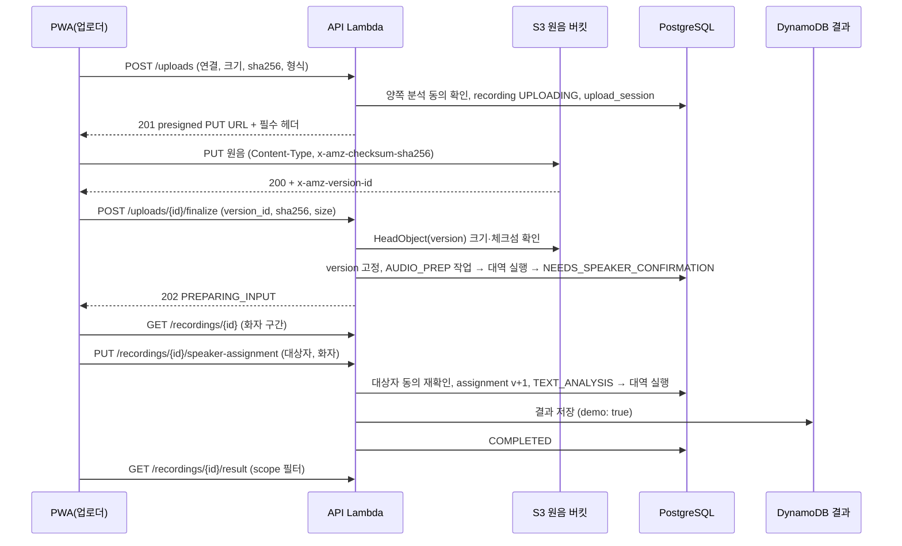

# MVP 녹음·분석 흐름 설계 (D8, #68)

기준일: 2026-11-08 · 상태: 설계(구현 전). 결정 근거는 [API 계약 정합성](api-contract.md) D8, 데이터 설계 원본은 umsal-pwa `docs/design/09_API_계약_및_데이터설계.md`다.

## 1. 범위 (D8 확정)

사용자 결정(2026-11-08): **음성 파일 1건 업로드 → 분석(처음엔 대역) → 본인 결과 확인 → 동의한 가족에게 공유 → 삭제**를 1차 범위로 한다. 분석 자리는 실제 모델 worker로 바꿀 수 있게 비워 둔다.

| 구분 | operation |
|---|---|
| 1차 구현(9개) | `createUpload`, `finalizeUpload`, `getJob`, `listRecordings`, `getRecording`, `assignSpeaker`, `getResult`, `deleteRecording`, `getDeletionStatus` |
| 2차로 미룸 | `retryJob`, `requestBulkDeletion`, `submitFeedback`, `getWeeklyReport`, `getSettings`·`updateSettings`, worker 4개(`claim`·`heartbeat`·`complete`·`fail`), `registerDevice`·`unregisterDevice`(D4) |

계약에서 operation을 지우지 않는다. 2차 operation은 계약에 남고 구현만 미룬다(`tests/test_contract_parity.py`는 구현된 operation만 비교).

## 2. 흐름

## 3. 대역 분석과 교체 자리

- `umsal_backend/analysis.py`에 `Analyzer` 프로토콜(`prepare_audio`, `analyze_text`)을 두고 1차는 `StubAnalyzer`만 구현한다. 원음 내용을 읽지 않는다(S3 `GetObject` 권한도 주지 않는다). 화자 구간은 고정 값(`spk_1` 0~5초, `spk_2` 5~10초), 결과는 고정 예시(`status: OBSERVED`, 요약 1문장, 관찰 1개 `WORRY`와 근거 발화 1개)이며 **응답 `demo: true`**, `limitations`에 "대역 분석 결과이며 실제 음성을 분석하지 않았어요"를 넣는다. umsal-pwa #17 완료 조건(GPU·예산 미정 상태를 즉시 분석 가능으로 표시하지 않음)에 맞춘다.
- 실행 방식: **API 요청 안에서 동기 실행**한다. `finalizeUpload`가 AUDIO_PREP 작업 행을 만들고 같은 트랜잭션에서 대역을 돌려 `SUCCEEDED`·`NEEDS_SPEAKER_CONFIRMATION`으로, `assignSpeaker`가 TEXT_ANALYSIS를 만들고 결과를 저장해 `COMPLETED`로 만든다. 응답 코드는 계약 그대로(finalize 202 `PREPARING_INPUT`). PWA는 `getJob`·`getRecording`으로 상태를 확인하므로 실제 비동기 worker로 바꿔도 클라이언트는 바뀌지 않는다.
- 교체 자리: 작업 행(`analysis_jobs`)은 계약의 stage·status·attempt·`pipeline_version`(`stub-1`)을 그대로 가진다. 실제 모델이 생기면 동기 실행 대신 outbox에 작업을 넣고 worker 4개 operation(claim·heartbeat·complete·fail)을 구현한다. 이때 바뀌는 곳은 `finalizeUpload`·`assignSpeaker`의 "대역 실행" 한 줄과 worker API 추가뿐이다.
- 대안(채택 안 함): jobs Lambda를 비동기 호출하거나 SQS로 대역 worker 실행. 발표용 1건 흐름에는 구성 요소만 늘고 실패 지점이 생긴다.

## 4. 데이터 모델 (마이그레이션 `0006`)

| 테이블 | 주요 열 | 규칙 |
|---|---|---|
| `recordings` | id(`rec_`), connection_id, uploader_id, occurred_at, filename, content_type, size_bytes, sha256, s3_key, s3_version_id, status, speaker_assignment_version, speaker_intervals(jsonb), current_job_id, deleted_at, created_at, updated_at | status는 계약 enum, 삭제는 tombstone(`deleted_at`) 우선. 조회는 참여자만, 삭제된 행은 숨김 |
| `upload_sessions` | id(`upl_`), recording_id, owner_id, expires_at, finalized_at | 한 번만 finalize, 만료 후 finalize 409 |
| `analysis_jobs` | id(`job_`), recording_id, stage, status, attempt, pipeline_version, assignment_version, failure_code, created_at, updated_at | `(recording_id, stage, assignment_version, pipeline_version)` unique |
| `speaker_assignments` | recording_id, version, target_subject_id, speaker_id, decision, confirmed_by, confirmed_at | PK(recording_id, version). `expected_version` 낙관적 잠금 |
| `deletion_jobs` | id(`del_`), scope(`RECORDING`), recording_id, requested_by, live_deletion_status, live_deleted_at, last_error_code, attempts, created_at | 202 응답 후 같은 요청에서 S3·DynamoDB 정리 시도, 실패 시 매일 정리 작업이 재시도 |

결과 본문은 DynamoDB `pk = REC#<recording_id>`, `sk = RESULT#<assignment_version>`에 저장한다(테이블은 3단계에서 만든 범용 pk/sk). 공개 여부는 PostgreSQL의 동의·삭제 상태로만 결정한다(storage.yaml 원칙: "이 테이블은 무엇을 보여 줄지 결정하지 않는다").

## 5. 권한·공개 규칙

- `createUpload`: 요청자가 연결 참여자이고 연결이 ACTIVE이며 **양쪽 분석 동의**(서로의 grant `analysis_allowed`)가 모두 켜져 있어야 한다. 아니면 403. `participants_permission_confirmed: true` 필수(계약). 한도 50MiB(413), 형식 enum 밖 415.
- `assignSpeaker`: 업로더만. `target_subject_id`는 연결 참여자, `speaker_id`는 그 녹음의 화자 구간 ID. 대상자의 분석 동의를 그 시점에 다시 확인한다. `UNSURE`는 `ABSTAINED`로 끝내고 결과를 만들지 않는다. 다시 지정하면 이전 결과는 비노출(새 version만 조회).
- `getResult`(결과 공개):
  - 대상자 본인: 전체(`summary`·`repetition`·`evidence`).
  - 다른 참여자: **대상자가 그 사람에게 준 공유 scope만**. scope가 비어 있으면 403(존재는 이미 목록으로 아는 참여자이므로 404로 숨기지 않는다).
  - 비참여자·삭제된 녹음: 404. 결과가 아직 없으면 409 `RESULT_NOT_READY`(계약 S5).
  - 응답 시점의 현재 동의·연결 상태로 매번 다시 거른다(연결 해제·동의 철회 즉시 반영).
- `getRecording`·`listRecordings`·`getJob`: 연결 참여자만. 해제된 연결의 녹음은 업로더에게만 보인다(삭제 요청용).
- `deleteRecording`: 업로더 또는 대상자. tombstone을 먼저 커밋해 즉시 비노출하고 202 `DeletionAccepted`.

## 6. 저장소·IaC 변경

| 대상 | 변경 |
|---|---|
| S3 키 | `recordings/<recording_id>/source` (녹음마다 새 키, 덮어쓰기 없음). finalize가 `version_id`를 고정 |
| presigned PUT | 15분, 서명 헤더 `Content-Type`·`x-amz-checksum-sha256`(신고한 sha256의 base64) → S3가 내용 체크섬을 검증. 응답 `required_headers`로 PWA에 전달 |
| `storage.yaml` | 원음 버킷 CORS: Origin = PWA CloudFront 주소와 로컬 개발 주소, Method PUT, 허용 헤더 `content-type`·`x-amz-checksum-sha256`, 노출 헤더 `x-amz-version-id`·`ETag` |
| `api.yaml` | 환경 변수 `AUDIO_BUCKET`, 실행 역할에 `s3:PutObject`(`recordings/*`, presign용), `s3:GetObjectVersion`(HeadObject), `s3:ListBucketVersions`(prefix `recordings/`), `s3:DeleteObjectVersion`, DynamoDB `GetItem`·`PutItem`·`DeleteItem`·`Query`(결과 테이블) |
| 네트워크 | VPC에 S3·DynamoDB 게이트웨이 엔드포인트가 이미 있다(`network.yaml`). presign은 네트워크 호출이 없다 |

주의: 원음 버킷의 이전 버전은 1일 뒤 만료된다. 키를 녹음마다 새로 만들고 presigned URL이 15분 뒤 만료되므로 고정한 version이 덮어써질 위험은 그 15분뿐이며, finalize는 PWA가 받은 `x-amz-version-id`를 고정한다. 계약 원안의 "accepted key로 고정 복사"는 대역 단계에서 생략하고 실제 worker 도입 때 넣는다.

## 7. 삭제

1. `deleteRecording`: `recordings.deleted_at` 설정 + `deletion_jobs`(PENDING) 커밋 → 202.
2. 같은 요청에서 커밋 뒤: S3 `recordings/<id>/` 모든 version·delete marker 삭제(D6), DynamoDB `REC#<id>` 항목 삭제 → `COMPLETED`. 실패하면 `FAILED`·`retryable`, 매일 정리 작업(`maintenance.py`, jobs 스택)이 재시도.
3. `getDeletionStatus`: 요청자만. `backup_status`는 RDS 자동 백업·DynamoDB PITR 보존 기간이 있으므로 `RETAINED_PENDING_EXPIRY`와 만료 시각을 보고한다.

## 8. 구현 순서 (각각 별도 PR)

1. 이 설계와 D8 확정(문서).
2. IaC: `storage.yaml` CORS, `api.yaml` 환경 변수·권한(harness 검토). AWS 반영은 배포 승인 때.
3. 마이그레이션 `0006`, `createUpload`·`finalizeUpload`·`getRecording`·`listRecordings`·`getJob`, 대역 AUDIO_PREP.
4. `assignSpeaker`·`getResult`, 대역 TEXT_ANALYSIS, DynamoDB 결과 저장·scope 필터.
5. `deleteRecording`·`getDeletionStatus`, 정리 작업 재시도.
6. AWS 배포(승인 필요): zip·마이그레이션·storage·api 스택.
7. umsal-pwa: 실제 업로드(파일 선택 → sha256 계산 → PUT → finalize), 화자 확인, 결과·가족 공유 화면, 삭제. 체험 모드와 실제 모드 구분 유지.

## 9. 남는 위험

- 대역 결과를 실제 분석으로 오해: 응답 `demo: true`·`limitations`와 PWA 표시로 막는다.
- 브라우저의 sha256 계산: 50MiB 파일은 Web Crypto `digest`로 메모리에서 계산한다(모바일 메모리 확인 필요).
- 원음 보관 기간·삭제 정책(umsal-pwa #19)은 미정이므로 합성·본인 동의 파일만 쓴다.
