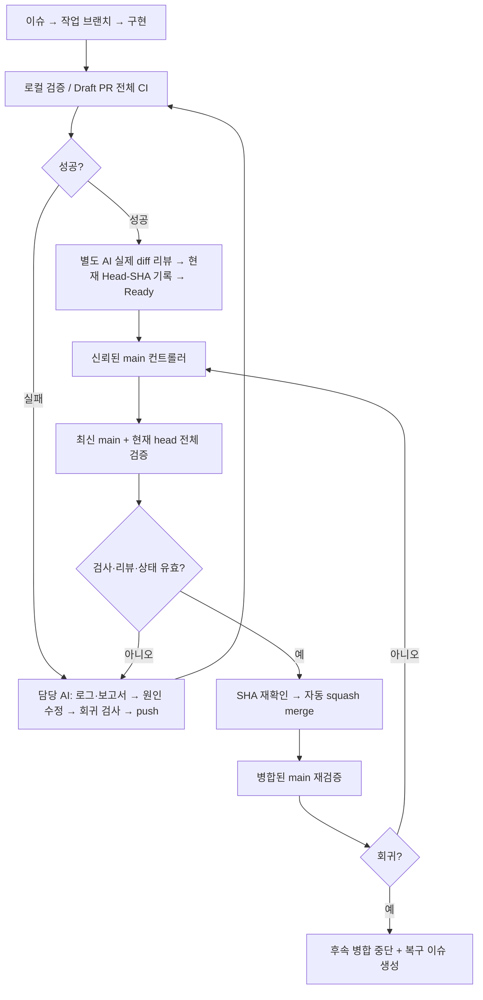

# 전체 코드 검증과 자동 main 통합

팀 AI는 구현·검증·독립 리뷰를 마친 PR을 Ready로 바꾼다. GitHub Actions가 현재 PR 검사, 최신 main의 정상 상태, **최신 main + PR head를 합친 코드의 전체 검사**를 확인하고 squash 병합한다. 사용자의 반복적인 검증·머지 클릭은 기본 절차에 없다.

## 검증 루프



다른 PR이 먼저 병합되면 새 main으로 통합 검사를 다시 요청한다. 동기화만을 위한 commit·리뷰를 매번 만들 필요는 없다. 실제 충돌은 담당 AI가 해결하고 새 head를 검토한다.

## 검사와 증거

| 검사 | 통과 조건 | 증거 |
|---|---|---|
| `policy` | 이슈·브랜치·commit·PR 양식·현재 head 독립 리뷰·민감 파일 정책 | 정책 workflow 로그 |
| `quality` | 전체 tracked tree의 비밀값 패턴·원음/모델/개인 환경 파일·큰 파일·symlink 검사, Git/병합 하네스 회귀 검사 | unittest·트리 검사 로그 |
| `python` | Ruff·포맷·FastAPI 앱/Lambda 핸들러 테스트(합성 이벤트, AWS 자격 증명 없음) | JUnit·coverage XML/JSON |
| `security` | Python 알려진 advisory 차단. 조회 장애도 실패 | pip-audit JSON |
| `harness` | `quality/python/security`가 **모두 success** | 최종 집계 로그 |

누락·실행 중·실패·취소·skipped·neutral은 성공을 대신하지 않는다. 보고서는 합성 자료만 사용해 14일 보관한다. PR 정책은 병합 직전 main 코드에서도 다시 검사한다.

커버리지 하한은 `umsal_backend` 패키지 branch 포함 총합 80%다. 새 파일도 측정 분모에 포함한다. 지표는 실행 범위이며 정확성 보증이 아니다. 기준 완화·파일 제외로 실패를 감추지 않는다.

## 모든 팀 AI의 절차

1. `AGENTS.md`·SPEC·이슈를 읽고 별도 clone/worktree의 `codex/<이슈>-<작업>`에서 시작한다. `make setup`으로 잠금 환경과 로컬 hook을 준비한다.
2. `make verify-fast`, PR 준비 시 `make verify`를 실행한다. 네트워크·도구 부재로 실행하지 못한 검사는 사유를 기록하고 원격 전체 CI 성공을 기다린다. 미실행을 통과로 적지 않는다.
3. 첫 의미 있는 commit을 push하고 Draft PR을 만든다. 실패 시 failing job과 아티팩트를 읽어 **원인 수정 → 관련 회귀 검사 → push → 재검증**한다. 동일 실패를 무작정 rerun하지 않는다.
4. 별도 AI가 실제 diff·인증/권한·실패 경로·검사 증거를 읽는다. PR의 `Reviewer:`·현재 `Head-SHA:`·결과를 실제 값으로 남긴다. CI/검증/운영 규칙 변경이면 `Review-Scope: harness`도 기록한다. 미해결 결함이 없을 때 Ready로 전환한다.
5. 이후 컨트롤러가 통합 검사·피드백·병합을 맡는다. 실패 댓글을 읽어 수정하고 새 head 리뷰도 갱신한다. **컨트롤러가 임의의 제품 코드를 고치거나 LLM에 전송하지는 않는다.** 수정과 의미 검토는 각 팀 개발 AI가 수행한다.
6. merged·main 재검증·이슈 종료를 확인해 보고한다. 코드 통합을 AWS 배포 완료로 표시하지 않는다.

```bash
make verify-fast       # 전체 소스 / Python
make verify-security   # 네트워크 advisory 조회 포함
make verify            # 위 검사 전체
gh pr checks <PR번호>
```

## 신뢰 경계

운영 값은 [ai-workflow.json](../.github/ai-workflow.json), 통합 정책은 [harness.json](../.github/harness.json), 실행은 [ci.yml](../.github/workflows/ci.yml)·[integrate.yml](../.github/workflows/integrate.yml)에 둔다.

- 쓰기 권한 컨트롤러는 **main만 checkout**한다. PR 코드를 실행/import하거나 PR 아티팩트를 실행하지 않는다. 제목·본문을 shell에 삽입하지 않는다.
- 후보 코드 검사는 `contents: read`이며 저장소/API/AWS 비밀값을 전달하지 않는다. 병합 권한은 main 컨트롤러에만 둔다. 별도 PAT·LLM 키를 추가하지 않는다.
- main의 dispatch CI가 끝나면 후보 코드/checkout이 없는 `notify-controller` job이 `actions: write`만 사용해 컨트롤러를 명시적으로 dispatch한다. 기본 token에서 후속 `workflow_run`이 전파되지 않는 경우를 처리한다. 알림 run ID는 종료 대기용이며 성공 판정으로 쓰지 않는다. 컨트롤러는 최대 30회 조회하며 종료를 기다린 후(조회 사이 2초, API 응답 시간 외 대기 합계 최대 58초) 현재 모든 증거를 다시 조회한다. 일반 PR에서 이 조건부 알림 job이 skipped인 것은 필수 검사 5개의 skipped를 허용하는 뜻이 아니다.
- Write 이상 팀원의 내부 PR만 처리한다. Draft·`harness:hold`·닫힌 작업 이슈·오래된 리뷰·미해결 리뷰 대화/변경 요청·충돌·잘린 파일 목록을 차단한다. rename 원래 경로도 검사한다.
- PR 최신 CI와 별도로 main dispatch의 **workflow 경로·저장소·event·main SHA·PR 번호·head SHA·최신 attempt의 실제 job**을 검사한다. 다른 PR·예전 base·이름만 같은 성공은 증거가 아니다.
- 전역 concurrency로 한 번에 하나만 병합한다. main·PR·리뷰·검사를 최종 재조회하고 REST merge의 `sha`로 head를 고정한다. 병합 직후 main 검사를 명시적으로 dispatch한다.

독립 AI 리뷰 기록은 신원 인증 서명이나 자동 외부 LLM 리뷰가 아니다. 각 팀 AI가 실제 별도 리뷰를 수행한다. 테스트 없는 미래 기능·모든 보안 결함·실제 AWS 배포·IAM 정책·실제 DynamoDB 동작을 현재 CI가 검증했다고 표시하지 않는다.

## 운영과 일시 중지

Actions 변수 `UMSAL_AUTO_MERGE=true`가 자동 피드백·검사·병합을 켠다. 초기 설치 PR은 기존 검증 도구로 병합하고 main 성공을 확인한 뒤 켠다. 개별 PR은 `harness:hold` 라벨로 보류한다.

```bash
gh variable set UMSAL_AUTO_MERGE --body false  # 전체 중지
gh variable set UMSAL_AUTO_MERGE --body true   # 재개
gh workflow run integrate.yml --ref main     # 큐 재확인
python3 tools/merge_controller.py             # 로컬 읽기 전용 계획
```

Ready/본문/라벨 변경·CI 완료 시 큐를 확인하고, 누락된 이벤트는 매시 17·47분 예약 실행으로 보완한다. GitHub 실행 지연·중단·사용량 한도 초과는 성공이 아니다. Draft는 자동 병합하지 않는다. 같은 head/base의 실패한 검사는 자동 반복하지 않는다. 명확한 외부 장애일 때만 담당 AI가 근거를 남기고 rerun한다. 중복 branch-push CI를 제거했으며 실제 Actions 사용량은 저장소 운영에서 확인한다.

## main 회귀와 복구

현재 main 검사 실패 시 SHA당 복구 이슈 하나를 만들고 일반 PR 병합을 보류한다. 자동 rollback·이력 재작성은 하지 않는다. token 병합 push의 workflow 전파에 의존하지 않고 `mode=main`을 명시적으로 dispatch한다.

담당 AI는 `UMSAL_AUTO_MERGE=false`로 큐를 멈추고, 현재 main을 포함한 fix/revert PR을 만든다. 복구 head 전체 CI와 독립 리뷰 성공을 확인한다. main 실패 상태에서는 일반 자동 경로가 막히므로 아래 도구로 **plan → execute**한다. 추가 사람 승인이 아니라 담당 AI의 근거 있는 복구 절차다.

```bash
python3 tools/ai_workflow.py merge <복구PR번호>
python3 tools/ai_workflow.py merge <복구PR번호> --execute
```

복구 후 main 전체 성공을 확인하고 자동화를 재개한다. 로컬 도구도 현재 head의 필수 5개 검사·독립 리뷰·미해결 대화·최신 main 포함을 요구한다. 거절된 상태를 `--admin`·직접 API·강제 push로 우회하지 않는다.

## 현재 서버 보호의 한계

2026-11-03 API 확인: Free 조직 private 저장소의 rulesets·branch protection은 403이다. 자동화 경로는 위 조건을 강제하지만 관리자의 직접 main push·설정 변경까지 서버가 막지는 못한다. REST merge는 head만 원자적으로 고정하므로 마지막 main 조회와 병합 사이의 관리자 직접 변경은 완전히 차단하지 못한다. 직렬화·최종 재조회·병합 후 검증으로 줄이며 strict protection이 필요하면 요금제 범위가 달라진다. 공개 범위·요금제·조직 권한을 바꾸지 않았다.

GitHub 설정의 실제 적용 상태는 [GitHub 설정 기록](github-settings.md)을 따른다.

## 공식 참고

- [보호 브랜치 요금제 범위](https://docs.github.com/en/repositories/configuring-branches-and-merges-in-your-repository/managing-protected-branches)
- [GitHub token과 workflow 이벤트](https://docs.github.com/en/actions/concepts/security/github_token)
- [workflow 이벤트의 보안 경계](https://docs.github.com/en/actions/reference/workflows-and-actions/events-that-trigger-workflows)
- [pytest 수정 안내](https://docs.pytest.org/en/latest/changelog.html)
